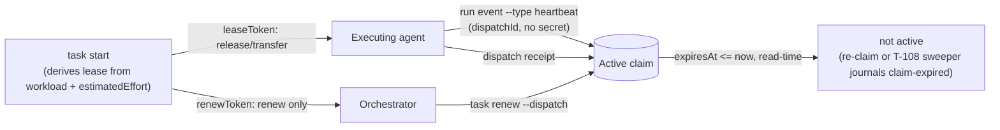
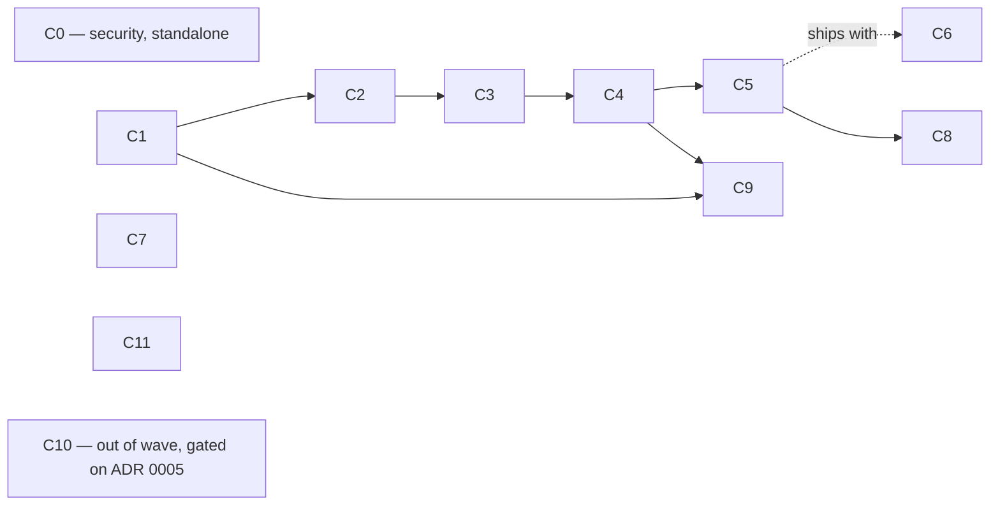

# Coordination v2 — leases, review lanes, and what `attempt` means

> **Status: design (T-124), not implemented.** Every change marked
> **PENDING OPERATOR APPROVAL** alters a public contract (a CLI flag, a
> protocol schema, or the observable semantics of an existing event) and must
> be approved before any implementation task is dispatched. There is exactly
> **one** approval label in this document: anything that meets that definition
> carries the full marker, and nothing carries a weaker one. (An earlier draft
> used a bare "PENDING" for three changes that meet the definition anyway —
> observable event semantics in §2 and §3, and changed forecast population in
> §4 — so an operator approving the fully-marked rows would have been
> shipping those under a quieter label. They now carry the full marker.)
> Section 10 consolidates every decision the operator actually has to make.
> This document decides direction; it writes no code and creates no board
> tasks.

Root cause R2 of the October 2026 agent-friction report — "rigid execution
model: one holder per claim, lease measured on the wall clock, token held only
by the holder, `attempt` used as a slice, no review role". R2 is the part of
MapCtx that survives the Option B question (see
[Option B and storage neutrality](#8-option-b-and-storage-neutrality)), so it
is the first thing worth fixing.

Sources: the friction report (22 frictions, 7 root causes), the earlier lease
RFC (ELA store, 280 tasks), and this repository's own store
(`9176b907-…`, read-only query on 2026-10-09).

---

## 1. Evidence

Measured in this repository's store, not estimated.

**Cut-off: events with `occurred_at <= 2026-10-09T15:19:00Z`.** Every number
in this section is pinned to that cut, and it has to be, because the store is
live and this document's own execution writes to it. Re-measured at
2026-10-09T20:19Z the same queries return 171 claims, 36 renewal events
across 18 distinct claims, 15 expiries, 175 dispatch attempts, 112 receipts,
and still zero run events — the shape of every finding holds, the integers
moved. ADR 0005 quotes a different cut of the same store on the same day
("158 claims, 162 attempts, 104 receipts"); both are honest, neither was
stamped, so the two documents read as contradicting each other. Hence the
stamp.

| Signal | Value | Reading |
| --- | --- | --- |
| `task.claimed` | 162 | — |
| `task.claim-renewed` | 26 events, 13 distinct claims | **8% of claims renewed at least once (13/162), not 16%** — 26 counts renewal *events*; several claims were renewed more than once, so the event count overstates how many claims ever got a renewal |
| `task.claim-expired` | 12 | journaled expiries |
| Claims in `state='active'` with `expiresAt` in the past | 9 (T-001…T-005, T-111…T-114, expired 2026-10-02) | ghosts, but not uniformly: T-001…T-005 (5) read `executionState=claimed` — a lie until the next claim on the same task touches it. T-111…T-114 (4) already read `executionState=completed` — the board calls the task done while the store still carries what looks like an open lock on it, the same lazy-expiry bug seen from the other side |
| Receipts spanning > 30 min (one full lease) | 44 of 104 (42%); 15 of 67 live, non-backfill receipts (22%) | the default lease is shorter than the work it covers |
| `dispatch.attempted` without a receipt | 62 of 166 (37%) | a dispatch stays valid long after execution stopped |
| `run.event-recorded` | **0** | the protocol already has `RunEvent.type = "heartbeat"`; nothing has ever emitted one |
| Dispatches by max attempt | 114×1, 3×2, 3×3, 2×4, 2×6, 1×7, 1×10 | the long chains are indistinguishable from genuine retries |

Three facts in the code set the hard boundaries of this design:

1. **`DEFAULT_LEASE_DURATION_MS = 30 * 60 * 1000`**
   (`packages/store/src/claims.ts:8`) and `leaseDurationMs` is **not exposed by
   the CLI** — not on `task claim`, `task start`, or `task renew`. Thirty
   minutes is not a default; it is the only value.
2. **One active claim per task is enforced in SQL**:
   `CREATE UNIQUE INDEX idx_resource_claim_active_task ON resource_claim_projection(task_id) WHERE state = 'active'`
   (`packages/store/src/schema.ts:117`). The reviewer's `active-claim-held` was
   not a policy choice that can be reasoned around; it is an index.
3. **`task_projection.execution_state` is a single scalar.** A task cannot be
   "running" and "under review" at the same time in that column.

And one bug independent of every option below: `getActiveClaimForTask`
(`projections.ts:389`) selects `state = 'active'` with **no expiry predicate**.
Expiry is lazy — only a later `claim`/`renew` on the *same* task journals
`task.claim-expired`. That is where the 9 ghosts come from.

---

## 2. Decision 1 — Lease renewal bound to the dispatch

**The problem.** Renewal requires `--claim <id> --token <leaseToken>`
(`mapctx-cli.ts:993`). The token is printed once, to whoever ran `task start`.
An orchestrator that dispatched the work holds the `dispatchId` but not the
token, so it cannot keep the lane alive; the executing agent must interrupt
itself every 20 minutes to do it by hand. It does not happen: 26 renewal
events across 162 claims, only 13 claims (8%) ever renewed at all (§1). The
field-friction report's account of leases expiring "four or more times during
one live T-124-class session" is **testimony, not an independently measured
figure in this store** — cited here as motivation, not evidence.

### Options

| # | Option | Cost | What it fixes | What it does not |
| --- | --- | --- | --- | --- |
| 1A | Longer fixed default (30 min → 4 h) + `--lease <duration>` | trivial | the common expiry | still holder-only renewal; a dead agent now blocks for 4 h instead of 30 min |
| 1B | **Derived `renewToken`**: `task start` prints a renew-only capability alongside `leaseToken`; renewal addressed by `(dispatchId, attempt)` | small | orchestrator can renew without gaining release authority | nothing about duration |
| 1C | **Liveness from run events**: expose `mapctx run event`; any run event (including `heartbeat`) extends the active claim | small–medium | renewal becomes a by-product of working, addressed by `dispatchId`, no secret | needs the agent to emit *something* at step boundaries |
| 1D | **Derive the default from planning data**: lease = f(`workload`, `estimatedEffort`) | small | the common case, with zero new ceremony | nothing about who may renew |
| 1E | Daemon heartbeat (background process renews while alive) | high | expiry | agents are turn-scoped processes, not supervisors; a wedged agent keeps renewing — liveness theater |

**1D deserves emphasis**: `appendTaskClaim` already *refuses to claim* an
executable task without both `workload` and a parseable `estimatedEffort`
(`claims.ts:52-75`), and `parseEstimatedEffortMs` already exists in
`@mapctx/protocol`. The inputs for a sensible lease are mandatory at claim time
and currently thrown away. A `Hard` / `2d` task receiving the same 30-minute
lease as a `Easy` / `30m` task is the bug.

### Recommendation

**1D + 1C + 1B, layered. Reject 1E. 1A only as the knob 1D computes.**

- **Default** lease = `clamp(parseEstimatedEffortMs(estimatedEffort) × 0.5, 30 min, 8 h)`,
  overridable by `--lease <duration>` and by `[coordination] defaultLease` /
  `maxLease` in `mapctx.toml`. The multiplier and the cap are operator-tunable;
  the point is that the lease is derived from the plan, not from a constant.
- **Liveness** from run events: expose the writer that already exists
  (`recordRunEvent`, `run.event-recorded`, `run_event_projection`) as
  `mapctx run event <dispatch-id> --type heartbeat|progress [--attempt n]
  [--sequence n] [--payload json]`, addressed by `dispatchId` — no token.
  `runEventSchema` requires both `attempt` and `sequence`
  (`protocol/src/envelopes.ts:41-49`), so the CLI cannot omit them: `--attempt`
  defaults to the dispatch's latest attempt and `--sequence` to the next
  unused sequence for that attempt, both overridable, and an explicit
  `--attempt` lower than the latest is refused rather than silently accepted.
  (Deriving the attempt makes "the caller's attempt matches the latest" a
  tautology, so the guarantee that matters is the refusal of an explicit stale
  one.)

  An event renews only when the resolved claim is unexpired and the dispatch's
  latest attempt has no landed receipt. The other cases, stated as the writer
  actually behaves rather than as the earlier draft assumed:
  - a **duplicate** `(dispatchId, attempt, sequence)` is rejected by
    `recordRunEvent` before any append — `duplicate-run-event`, or
    `conflicting-run-event` if the payload differs (`dispatch.ts:198-203`). It
    is **not** journaled, so it cannot renew by construction; no new rule is
    needed, and the earlier claim that duplicates are "journaled but never
    renew" was simply wrong about the code;
  - a **stale attempt** or an attempt that already reached a terminal receipt
    **is** accepted today — the writer only checks that the attempt exists
    (`dispatch.ts:195-197`). That is where the new rule actually applies:
    accepted and journaled for the record, but it must not renew, or a late
    or replayed heartbeat from a superseded attempt extends whoever holds the
    claim now.
  Accepted renewals extend the claim by the lease duration and journal
  `task.claim-renewed`. **No daemon**: the agent emits an event where it
  already pauses — after a test suite, between slices — the same moment it
  would have run `renew`.

  **Heartbeats must not become time measurements.** This is the sharpest
  edge in the whole decision, and it points back at this decision's own
  foundation.
  `durationMeasuresFromReceipt` substitutes `activeTimeMs =
  sessionWallClockMs` with `activeTimeCoverage: "substituted"` exactly when a
  receipt has no interior run events (`forecast/src/duration.ts:198-215`) —
  which is every receipt in the store today, since nothing has ever emitted a
  run event. The moment C4 makes agents emit heartbeats, the other branch
  takes over, and `activeTimeMs` sums **only inter-event gaps smaller than
  `DEFAULT_IDLE_THRESHOLD_MS = 10 min`** (`duration.ts:4,27-38`). A four-hour
  run heartbeating every ~20 minutes — the cadence actually observed in the
  renewal chains of this store — has no gap under the threshold, so it
  measures **≈0 active time instead of four hours**, and the coverage label
  stops saying `"substituted"`, i.e. the corrupted sample now looks *more*
  trustworthy than the honest one it replaced. That would poison precisely
  the receipt-duration calibration that the derived lease reads from, and
  that §7 proposes to re-derive the lease factor from. A liveness signal must
  not be mistaken for evidence of work: **`type='heartbeat'` is excluded from
  `interiorEvents`**, so emitting heartbeats leaves the measurement exactly as
  it was. `packages/forecast/src/duration.ts` therefore belongs to C4, with a
  test asserting a receipt with heartbeats measures the same active time as
  the identical receipt without them.

  **Which lane does a heartbeat renew?** Today the question is vacuous —
  one claim per task, so dispatch → `taskId` → the claim is unambiguous.
  After §3 introduces shared review claims it stops being vacuous, and the
  cheap answer is wrong: resolving by `taskId` alone means a heartbeat on a
  *review* dispatch can extend the *implement* lease, which is precisely what
  §3 forbids when it says review must not be able to stall the work it
  reviews. Renewal must therefore resolve the claim by `(taskId, role)` taken
  from the dispatch's own `kind`. Since C4 lands before C5 in the plan, **C4
  ships implement-only and says so**: it resolves the single claim, and its
  tests assert that once `kind` exists a review heartbeat renews nothing
  until C5 teaches the resolver about roles. The alternative — deferring
  renewal-by-event until C5 — costs a wave for no benefit, because the
  single-claim resolution is correct for every dispatch that exists before
  C5. What is **not** acceptable is the earlier plan's silent version of
  this, where C4 was written in a one-claim world and never revisited: the
  run-event renewal path is now an explicit member of §3's role-aware
  call-site list.

  This path is intentionally secret-free, which is a trust decision, not an
  oversight: anyone who can reach the local CLI/store already has that
  trust level (§8 restates this — "local DB/journal readers are trusted, not
  a security boundary"), and the worst a spurious heartbeat can do is keep a
  lease alive longer, never seize or release it. Two things bound the damage
  of a wedged-but-still-heartbeating agent, since evidence-based liveness
  alone would otherwise renew forever: an **absolute ceiling of 24 h from the
  original `claimedAt`**, after which no renewal path — heartbeat or explicit
  — extends the claim, only a fresh `task start` (the existing reclaim path,
  verified live in this attempt: it already expires the stale claim and mints
  a new one atomically); and the attempt-chain warning (§4) catching the
  "keeps renewing, never finishes" pattern from the other side.
- **Explicit renewal** stays available and gains a dispatch address, but drops
  the earlier HMAC idea — recomputing `HMAC(leaseToken, …)` to verify a renewal
  still requires reading `leaseToken`, so it was never actually secretless, it
  just renamed the same dependency. Simpler and honest instead: `task
  start`/`task claim` mint **two independent random tokens** at claim time,
  stored together in `resource_claim_projection` and in the `task.claimed`
  payload — `leaseToken` (release, transfer, and renewal) as today, plus a new
  `renewToken` (renewal only). `task renew --dispatch <id> --renew-token
  <token>` checks the presented token by constant-time equality — a
  comparison, not a recomputation, so there is no algorithm to pin down and no
  secret the verifier needs to fetch from anywhere but the one row it already
  owns. An orchestrator holding `renewToken` can keep the lane alive but
  cannot `release` or transfer the claim, which still requires `leaseToken`.
  Capability split by **possession**, not by a derivation that quietly
  re-requires the thing it was meant to avoid.

  **Tokens are scoped to the `claimId`, not to `(dispatchId, attempt)`** —
  correcting a scope this document asserted twice while the data model cannot
  express it. A claim carries no dispatch reference anywhere: not in
  `resource_claim_projection` (`schema.ts:106-116`), not in the `task.claimed`
  payload (`{claimId, taskId, leaseToken, holder, claimedAt, expiresAt}`,
  `claims.ts:101-107`), and `dispatch_projection` carries no `claim_id` (its
  key is `(dispatch_id, attempt)`). The only edge between the two is
  `task_id`. Worse, the lifetime is genuinely not per-attempt: `task claim`
  mints a claim with **no dispatch at all** (`mapctx-cli.ts:730-737`), and
  `dispatch create` opens attempt N+1 against the **existing** claim
  (`mapctx-cli.ts:1402-1409`), so one claim legitimately spans several
  attempts. Scoping a token to an attempt would invalidate it on every retry
  of work that never changed holders. So:
  - the authoritative scope is `claimId`, and both tokens live and die with
    that row — no schema change beyond the `renew_token` column, no payload
    change beyond the added token;
  - `--dispatch <id>` is a **lookup, not the scope**: resolve dispatch →
    `taskId` → that task's live claim for the dispatch's own role (§3 makes
    role the disambiguator once review claims exist; before that there is
    only one claim per task and the lookup is unambiguous);
  - `task renew --claim <id> --token <leaseToken>` **stays**, unchanged, and
    is the only renewal path for a claim that has no dispatch — which is
    exactly what `task claim` produces;
  - a renewal is refused when the resolved claim is expired, or when the
    dispatch's latest attempt already has a landed receipt. "Latest open
    attempt" remains the admission rule for the *dispatch*; it is not the
    token's scope.

  **The clock is a trust boundary too, and an undeclared one so far.** Every
  expiry, every renewal, and the 24 h ceiling are computed from
  `options.now ?? (() => new Date())` (`claims.ts:40`, `:149`) — the local
  clock of whichever process renews. A ceiling measured by the same clock it
  constrains does not hold against a clock that is wrong: skew the clock back
  and the lease extends indefinitely. This is accepted at the same level as
  §8's secret handling — the local CLI and its clock are trusted to the same
  degree — and it is stated here rather than discovered later. A
  multi-host backing store (§8) would need a clock it does not take from the
  renewing party.

- **Redact the claim refusal — this is a live leak today, not hygiene for
  later.** `print` is a bare `JSON.stringify` with no redaction
  (`mapctx-cli.ts:278-284`), and the `active-claim-held` refusal returns
  `activeClaim: active` (`claims.ts:93`) — a whole `ResourceClaimRecord`,
  which includes `leaseToken` (`types.ts:87-97`). Both entry points print that
  refusal verbatim: `taskClaimCommand` (`mapctx-cli.ts:735-736`) and
  `taskStartCommand` (`mapctx-cli.ts:1353-1354`), the latter being what the
  CLI's own help calls the preferred execution entry point and what every
  agent in this epic actually runs. `startTask` returns the refusal object
  untouched (`start.ts:35-36`), so nothing in between strips it. **Consequence
  today: any agent that runs `mapctx task start` against a task somebody else
  holds is handed that holder's `leaseToken` — that is `release` and transfer
  authority over another agent's claim, printed on refusal.** An earlier draft
  of this document filed this as "output hygiene", cited only one of the two
  call sites, and parked the fix inside C3, third in a serialized chain. It is
  none of those things: it is a pre-existing security defect, it is
  independent of everything else here, and it is now **C0** — first, alone,
  roughly an hour. The fix is redaction at the source (refusals carry
  `claimId`, `holder`, `expiresAt`, never token fields) rather than at each
  print site, so a future caller cannot reintroduce it; `RenewResult`
  (`claims.ts:145-182`, printed at `mapctx-cli.ts:993-999`) gets the same
  treatment. None of this claims confidentiality against a principal with
  direct DB or journal access — see §8 — only against handing authority to
  whoever merely asked for a task.
- **Independently of all of the above**, fix read-time truth — but precisely,
  because the naive fix breaks reclaim. `claimTask`
  (`claims.ts:77-105`) already handles expiry correctly on the **admission**
  path: it calls `getActiveClaimForTask` to find the stale row, journals
  `task.claim-expired` for it, and only then inserts the replacement — all
  before the partial unique index (`schema.ts:117`) ever sees two `active`
  rows. We verified this live while writing this revision: reclaiming T-124's
  own attempt after its lease expired returned `"expiredPrevious":
  "<claimId>"` and succeeded in one call, no sweeper involved. Dispatch
  admission (`dispatch.ts:69-73`) also already rejects an expired lease. **The
  bug is narrower than the first draft of this doc claimed: it is stale truth
  on paths that never go through admission** — and narrower still than the
  second draft claimed, which named `plan` and `task show` as the victims.
  Neither displays claims: `task show` returns task plus detail
  (`context.ts:198-207`) and `plan` sends six fields to the planner
  (`mapctx-cli.ts:849-858`). In fact **nothing** displays claims today;
  `resource_claim_projection` is read in exactly two places
  (`projections.ts:389` and `:395`) and the only non-test callers are
  `claims.ts:77` (claim admission), `dispatch.ts:70` (`dispatch create`
  admission) — both correct — and one live misreader:
  **`tasks.ts:76`**, which on `move done`/`cancelled`/`archived` fetches the
  unfiltered active claim and journals `task.claim-released` for it. Against
  a ghost that writes a release event for a lease that expired days earlier,
  recording a fiction in the audit trail. That is the one real consumer the
  expiry-filtered getter has today, so it is the one C1 must fix; the display
  readers that the earlier drafts imagined arrive only with C8, which is
  where the "no ghost on any read path" target actually becomes measurable.

  Filtering `getActiveClaimForTask` itself by expiry would "fix" that symptom by
  breaking admission: a filtered getter would stop seeing the stale row,
  skip journaling its expiry, and then the insert would hit the still-`active`
  row's unique-index entry and fail. So the fix is **two getters, not one**:
  `getActiveClaimForTask` (unfiltered — used only by the admission/reclaim
  path, which must see and expire the stale row before inserting) stays
  exactly as it is; a new `getLiveActiveClaim` (expiry-filtered) is what
  `tasks.ts:76` uses, and what every display reader added later (C8) uses by
  default. The admission path's expiry-then-insert already happens atomically
  in one transaction — the new work is adding the filtered getter, pointing
  the one live misreader at it, and locking the behavior down with tests for
  the exact expiry boundary, reclaim with no sweeper involved, and a `move
  done` over an expired claim journaling no release event.

### Impact

| Layer | Change | Approval |
| --- | --- | --- |
| Protocol | `task.claimed` payload gains `renewToken` — an independent random capability minted at claim time, scoped to the `claimId`, not derived (additive; absent on the 162 existing events, which is fine, none is still `active`) | **PENDING OPERATOR APPROVAL** |
| Protocol | no new event type — `RunEvent`/`run.event-recorded` already exist | — |
| Store | **C0, independent:** claim refusals stop carrying token fields at the source (`claims.ts:93`), so no print site can leak them | **PENDING OPERATOR APPROVAL** (removes `activeClaim.leaseToken` from observable CLI output — a fix, but a visible one) |
| Store | `claims.ts` derives lease duration, mints `renewToken`, resolves renewal through dispatch → task → live claim, enforces the 24 h absolute ceiling; `projections.ts` adds `getLiveActiveClaim` alongside the unchanged `getActiveClaimForTask`; `forecast/src/duration.ts` excludes heartbeats from interior events | **PENDING OPERATOR APPROVAL** (observable semantics of an existing event) |
| CLI | `--lease <duration>` on `task claim`/`task start`; `task renew --dispatch/--renew-token` (with `--claim/--token` unchanged); new `mapctx run event` with `--attempt`/`--sequence`; redacted refusal/renew output | **PENDING OPERATOR APPROVAL** |
| Config | `[coordination] defaultLease`, `maxLease`, `leaseFactor` in `mapctx.toml` | **PENDING OPERATOR APPROVAL** (new public config surface) |

**Data migration.** `resource_claim_projection` gains a `renew_token` column
(backfilled `NULL` for the 162 historical rows — none of them is still
`active`, so there is nothing to reclaim retroactively; a row only needs a
`renewToken` from the claim event onward). No index is altered by this
decision alone (the `exclusivity` index change belongs to §3). The 9
ghost active claims do **not** self-heal by this decision: they stop reading
as `active` on the new `getLiveActiveClaim` path the moment it ships, but
their rows stay `state='active'` in the table until something re-claims that
task — admission-time expiry, not a background sweep, is what actually
flips the row (see [T-108](#5-decision-4--the-fate-of-t-107-and-t-108) for
the sweeper that forces that touch for tasks nobody re-claims on their own).

**Compatibility break.** **None from the read-time fix** — and the earlier
drafts' claim that there was one has to be withdrawn explicitly, because it
was the sole justification for C1 carrying an approval marker. Both drafts
said "a caller that today receives `active-claim-held` from an *expired*
claim will start succeeding". No caller can receive that: `claims.ts:93` is
the only producer of `active-claim-held` in the repository, and it is reached
only *after* the expiry branch at `:81-90` has already converted an expired
claim into a reclaim — with the projection updated inline in the same
`BEGIN IMMEDIATE` (`store-handle.ts:222-250`). The refusal is unreachable for
an expired lease in this commit, so nothing observable changes and C1 is an
internal addition. The breaks that remain in this section are the ones from
the renewal redesign and the redaction (C0): a caller parsing `leaseToken`
out of a refusal payload will stop finding it, which is the point.

Longer default leases also mean a genuinely dead holder
blocks for longer — which is precisely why 1C (liveness evidence) is designed
in alongside the lease derivation here, not added later. The sweeper (T-108,
C9) is a different kind of dependency: it must land **after**, not alongside,
because it depends on the read-time fix (C1) to tell a true ghost from a
holder nobody has re-claimed yet (§6's waves place it last for that reason).

---

## 3. Decision 2 — Concurrent review dispatch

**The problem.** A reviewer ran `task start` on a task under implementation and
got `active-claim-held`. Independent review therefore happens entirely outside
MapCtx — this epic alone holds dozens of `t1xx-review-attemptN` artifacts that
the store has never heard of. The board cannot say a task was reviewed, by
whom, or how many attempts it took.

### Options

| # | Option | Mechanism | Verdict |
| --- | --- | --- | --- |
| 2A | `reviewing` executionState | add to `executionStateSchema` + `EXECUTION_TRANSITIONS` | **reject as the primary mechanism.** `execution_state` is one scalar describing *the task's* run, and review is a *second, concurrent* run. Encoding it as a state re-serializes exactly what we are trying to parallelize, and it collides with the journaled retry-admission resets in `dispatch.ts:79-103`. It also puts coordination truth inside `task_projection` — the row that migrates to the provider under Option B. Keep "has an open review dispatch" as a **derived read**, never stored state. |
| 2B | **Dispatch kind** | `Dispatch.kind: "implement" \| "review"`, default `implement` | **recommended.** The dispatch is already the unit of work, of attempts, and of receipts. A review dispatch gets its own `dispatchId`, its own attempt counter and its own receipt, so `evaluateRunReceipt` — which is scoped per `dispatchId` — keeps implement and review attempts from ever invalidating each other. That is the clean seam. |
| 2C | **Claims by role** | lease gains `exclusivity: "exclusive" \| "shared"` + `role`; index becomes `UNIQUE(task_id) WHERE state='active' AND exclusivity='exclusive'` | **recommended, additive to 2B.** Without it the review lane is invisible again — no holder, no lease, no liveness accounting, one layer deeper. Named `exclusivity`, not `mode`: `ResourceClaim.mode: "read" \| "write"` already exists in `packages/protocol/src/entities.ts:149-166` for the planner's file-level resource locking (`planner/src/index.ts:197`, which T-125 is actively changing) — same entity name, unrelated concept, different layer. Reusing `mode` here would collide in review and in anyone's mental model; it does not collide in the database, since the lease record (`packages/store/src/types.ts:87-97`) is a distinct table from the planner's resource claims. |

### Recommendation

**2B + 2C together; 2A only as a derived field in `plan` output.**

- `mapctx task start <id> --kind review` takes a **shared** claim and opens a
  **review** dispatch. It is never refused because an implement claim is held.
- `implement` keeps the exclusive claim and the `requireActiveClaim` admission
  it has today. A shared review claim never blocks implementation: review must
  not be able to stall the work it reviews.
- A **review receipt does not drive the task's execution or planning state.**
  It records the review outcome against its own dispatch. `completed` on a
  review dispatch must not move planning to `review` and must not touch
  `executionState`; promoting `review → done` or sending it back to
  `in-progress` stays an explicit orchestrator or operator decision. This needs
  `assertReceiptPlanningAdmission` (`projections.ts:1359`) and the guard in
  `dispatch.ts:276` to branch on `kind`.
- **This has to hold everywhere a claim or a dispatch currently assumes "one
  task, one lane", not only at receipt time.** A shared review claim is a
  second claim on a task that already has an exclusive implement claim —
  every applier that currently reasons from "this task's active claim" must
  become kind/role-aware, or releasing/expiring the *review* claim will reset
  the *implement* lane's `executionState` out from under a holder who is
  still working. Concretely: the claimed/released/expired appliers
  (`events.ts:237-269`), the dispatch applier (`events.ts:292-309`), dispatch
  admission and the retry-admission reset (`dispatch.ts:78-103`), both
  receipt-transition paths (`dispatch.ts:288-305`, `projections.ts:866-909`),
  **and the run-event renewal path introduced in §2** — which the earlier
  draft omitted from this list while scheduling it (C4) to land a wave
  *before* roles exist, so it would have been written in a one-claim world
  and never revisited. All of them reason from "this task's active claim" as
  if there can only ever be one, and
  each needs an explicit "mine to touch, or not" check. Test the
  interleavings directly, not just the happy path: review claim released or
  expired while the implement claim is still active; both receipt orders
  (review lands first, implement lands first); a review in flight against an
  implementation that then fails; a heartbeat on a review dispatch leaving
  the implement lease untouched; and legacy (pre-`kind`) event replay, which
  must keep behaving as implement-only. **The review CLI (`--kind review`)
  ships only once this and C6 (review receipt admission) land together** —
  shipping 2B/2C's schema and claim before the lifecycle guards would open the
  review lane before the thing it's supposed to not break is actually
  protected.
- `plan` gains a derived `review: { open, attempts, lastOutcome }` per task.
  Nothing is stored that a projection cannot rebuild.
- **Forecast calibration stays implement-only.** `packages/forecast/src/
  store.ts:39-64,75-84` reads every receipt as a workload-duration sample
  with no `kind` filter; once review dispatches exist, a quick review
  receipt on a `Hard` task would be read as "`Hard` tasks finish fast,"
  corrupting exactly the estimate `estimatedEffort` now has to earn its keep
  for (§2). Review time and implementation time are different populations;
  the join excludes `kind != 'implement'` unconditionally, filed under C6
  alongside the planning/execution admission guard, since both are the same
  kind of leak — a review outcome reaching somewhere it shouldn't.

### Impact

| Layer | Change | Approval |
| --- | --- | --- |
| Protocol | `dispatchSchema` gains `kind` (default `implement`); `Dispatch.v1.json` regenerated | **PENDING OPERATOR APPROVAL** |
| Protocol | claim payloads gain `exclusivity` and `role` (absent = `exclusive`/`implement`) | **PENDING OPERATOR APPROVAL** |
| Store | `dispatch_projection` `ADD COLUMN kind`; `resource_claim_projection` `ADD COLUMN exclusivity, role` — `NOT NULL DEFAULT` with a `CHECK` enum, which fills existing rows in the same statement; then drop and recreate `idx_resource_claim_active_task` **under the same name** with the `exclusivity='exclusive'` predicate (see migration below for why both the order and the name matter); `packages/store/src/types.ts:87-97` gains the new fields | **PENDING OPERATOR APPROVAL** |
| Store | adds `listActiveClaims` and a role-aware exclusive lookup; **`getActiveClaimForTask` stays unchanged** (the earlier draft said it "splits into" new getters, contradicting §2 and C1, which both promise it is untouched — three plans for one function, now one); receipt admission, the lifecycle appliers listed above, and the run-event renewal path branch on `kind`/`role` | **PENDING OPERATOR APPROVAL** (semantics of `run.receipt-recorded` and of claim release/expiry) |
| CLI | `task start --kind review`, `dispatch create --kind review`, review columns in `plan` | **PENDING OPERATOR APPROVAL** |

**Data migration.** A nullable column here would be unsafe, and the previous
draft's recipe for avoiding that did not execute. Both halves matter, so both
are spelled out.

Why not nullable: if the new partial index reads `WHERE
exclusivity='exclusive'`, a legacy row with `exclusivity=NULL` does **not**
match it and stops being covered by the uniqueness constraint, while the
application layer still treats it as exclusive — so a second,
explicitly-`'exclusive'` claim inserts on the same task with no UNIQUE
violation, giving two effective exclusive holders. Verified in a scratch
database, not reasoned about: with a nullable column the second insert
succeeds.

The executable order, also verified in a scratch database:

1. `ALTER TABLE resource_claim_projection ADD COLUMN exclusivity TEXT NOT
   NULL DEFAULT 'exclusive' CHECK (exclusivity IN ('exclusive','shared'))`,
   and the same shape for `role`. SQLite accepts `NOT NULL DEFAULT` + `CHECK`
   on `ADD COLUMN` and **fills every existing row with the default as part of
   the same statement** — so there is never a `NULL` window, and the separate
   backfill is unnecessary.
2. `DROP INDEX` then `CREATE UNIQUE INDEX` for
   `idx_resource_claim_active_task` with the `exclusivity='exclusive'`
   predicate — **reusing the exact same index name**, which is not cosmetic:
   `schema.ts:117` executes `CREATE UNIQUE INDEX IF NOT EXISTS
   idx_resource_claim_active_task … WHERE state = 'active'` on *every* store
   open, and it is a harmless no-op only because that name already exists. A
   differently-named new index would leave the old predicate being recreated
   on the next open, enforcing the pre-migration invariant forever alongside
   the new one.

The previous draft inverted 1 and 2 and put an `UPDATE … SET
exclusivity='exclusive'` first — updating a column that the next step
creates. That fails with `no such column: exclusivity`, and because the
runner wraps each migration in a single `BEGIN IMMEDIATE` with `ROLLBACK` on
error (`db.ts:45-53`), the whole migration aborts and the store fails to
open. Atomicity was never the problem; statement order was.

`dispatch_projection.kind` gets the identical treatment — one migration
pattern, not two null-handling philosophies — even though `kind` alone does
not sit inside a unique index today. Replay must apply the same defaults
(absent `kind`/`exclusivity`/`role` on an old event → `implement`/
`exclusive`/`implement`) so a database rebuilt from the event log matches one
that was migrated in place. Tests: migrate a copy of a legacy store and
assert the store opens, the index carries the new predicate under the old
name, and no row holds a `NULL`.

**Compatibility break.** None for readers that ignore unknown fields. One for
writers: a `completed` review receipt no longer carries planning to `review`.
That is new surface, not changed surface — no review dispatch exists today.

---

## 4. Decision 3 — Slices become subtasks; `attempt` means retry

**The problem.** T-211 was executed as slices S1/S2/S3 run as `attempt` 1, 2
and 3 of a single `dispatchId`. This is not merely untidy; it breaks three
mechanisms that are load-bearing:

1. **Receipts are lost.** `evaluateRunReceipt` rejects any receipt whose
   `attempt` is lower than the latest dispatched attempt as `stale-attempt`
   (`attempt-lifecycle.ts:65-68`). Once S2 is dispatched, S1's receipt is
   unacceptable — by design, because that rule exists to stop a late attempt
   from overwriting a newer one.
2. **Execution state is reset as if reopening unfinished work — not marked
   failed, and nothing is lost.** Dispatching a new attempt against a
   `completed` execution journals a reset to `unclaimed` with `source:
   "retry-admission"` (`dispatch.ts:79-103`). That is an admission patch, not
   a verdict: no receipt is deleted or overwritten, and the prior slice's
   `completed` receipt stays fully queryable. The actual problem is semantic,
   not data loss — every new slice's admission record reads as "this needed
   to be reopened," which is a false signal about work that in fact finished
   and simply had more work queued after it.
3. **Forecasting is poisoned.** `workloadAtDispatch` and `workloadAtReceipt`
   are frozen per attempt specifically to calibrate estimates for *a whole
   task* (T-071). A three-slice task teaches the model that `Hard` tasks need
   three attempts.

Observed chains of 10, 7, 6, 6, 4 and 4 attempts are indistinguishable from
genuine retries today — and when actually inspected (see the measurement
below the recommendation), the long chains in *this* store turn out to **be**
genuine retries: review loops, not disguised slices. The mechanisms above
still break when slices are run as attempts; what this store does not supply
is evidence that it is happening here at scale.

### Options

| # | Option | Verdict |
| --- | --- | --- |
| 3A | Normative only — document "`attempt` = retry", update the skills | necessary but insufficient. Free, ships immediately, and will be ignored again whenever a task is too big and creating subtasks feels expensive. |
| 3B | **Subtask ergonomics + a warning** | **recommended.** Make the correct path the cheap one, and make the wrong one visible. |
| 3C | First-class `slice`/`step` field on `Dispatch` | **reject.** It builds a second hierarchy beside the task tree, which already has `parentTaskId` and `deriveSubIssueProgress`. Decisively: slices need their own **acceptance criteria**, which tasks have and dispatches never will. Modelling slices on the dispatch means a slice can never be independently accepted. |

### Recommendation

**3B, with 3A shipping first because it costs nothing.**

- `mapctx task split <task-id> --slice "S1 title" --effort 2h --slice "S2
  title" --effort 4h` creates child tasks inheriting `domains`, `role`, and
  the parent's `workload` class, with `parentTaskId` set to **the task being
  split** (the slices are its children, consistent with
  `deriveSubIssueProgress` already aggregating child progress upward).
  `--effort` pairs positionally with the `--slice` it follows; a `--slice`
  with no `--effort` after it is refused. The earlier `--slice
  "title:<effort>"` form is dropped because it has no unambiguous parse —
  task titles in this very board contain colons (`[T-124] R2 design:
  renovacao de lease…`), so splitting on `:` is a guess. Three
  things the first draft left undefined, now pinned down:
  - **Effort is mandatory per slice, with no invented default.** Claim
    admission already refuses an executable task without a parseable
    `estimatedEffort` (`claims.ts:52-75`); `workload` class alone doesn't
    imply a duration, so `task split` surfaces that same refusal immediately
    if a `--slice` omits `:<effort>`, rather than dividing or copying the
    parent's estimate and inventing a number nobody actually judged.
  - **Acceptance is optional at split time, like any other task.** It has no
    special default and needs none: a task is claimable without acceptance
    criteria today (only `done` requires approved ones), so a slice follows
    the normal path — attach acceptance via `task acceptance revise` before
    anyone tries to finish it, whenever that happens to be.
  - **Dependency ordering defaults to none.** Slices are independent and
    claimable in any order unless the operator explicitly links them with
    `--depends-on` (the existing flag, pointed at sibling slice IDs) —
    imposing sequential order by default would just recreate the
    attempt-as-slice coupling this decision exists to break, one layer down.
  - **`task split` does not dispatch.** It creates the child tasks and stops;
    claiming and dispatching each slice stays an explicit, separate decision,
    same as for any task. (The first draft said each slice gets "its own
    dispatch" from `split` itself — that overstated it: `split` is a planning-
    tree operation, not an execution trigger.)
  One command still replaces "create, set workload, set estimatedEffort, set
  parent, link" per slice — the friction that made `attempt` look attractive
  — it now also forces the one input (`estimatedEffort`) that the old
  friction let agents skip.
- A **warning, never a refusal**, when a dispatch reaches `attempt >= 4` with
  no intervening `failed` or `blocked` receipt. Refusing would strand
  legitimate retry chains.
- **The warning does not feed a calibration exclusion** — the measurement
  below refutes the previous draft's position, which was to exclude flagged
  chains from calibration permanently. The warning stays (cheap, prints only,
  and "four attempts and still going" is worth a human glance whatever the
  cause); the exclusion is dropped, because attempt count is not evidence of
  scope change.
- Calibration **does** exclude `kind != 'implement'` receipts (§3): review
  time and implementation time are different populations, and that exclusion
  is about which population a sample belongs to, not a judgement about the
  chain it came from. The `attempt >= 4` predicate still belongs in a shared
  helper rather than duplicated, so the warning and any later analysis ask
  the same question the same way — but its only consumer is now the warning,
  not `packages/forecast/src/store.ts`'s calibration joins.

### The measurement that killed the exclusion

The previous draft called `attempt >= 4` with no intervening failure receipt
"the signature of slice abuse" and excluded those chains from calibration
"permanently … nothing to reinstate". Measured against this store, the
predicate does not identify slice abuse at all — it identifies the review
loop this document endorses.

| | Measured (cut 2026-10-09T20:19Z) |
| --- | --- |
| Chains matching `attempt >= 4`, no `failed`/`blocked` receipt | 8 |
| Their receipts | 38 of 112 (34%) — the longest samples in the store |
| Outcome of those 38 receipts | **every one `completed`** |

Those chains are review-fix-redispatch loops: repeated attempts at the *same*
contract after review, which is exactly what this section says `attempt` is
*supposed* to mean. The predicate cannot separate the pattern this document
endorses from the one it condemns, because what it actually measures — "many
attempts, none failed" — is the fingerprint of both.

The honesty check is immediate: **dispatch `5e645038` matches the predicate.
That is T-124's own dispatch — this document, on its fourth attempt after two
review rounds.** A rule whose first catch is the document proposing it, with a
consequence designed to be irreversible, does not belong near calibration
input.

If an exclusion is wanted later it must key on evidence of *scope* change
rather than attempt count — two or more `completed` receipts in one chain with
disjoint `changedFiles` is what slicing actually looks like — and it must be
reversible. Deferred, not adopted: nothing excludes anything until `task
split` exists and gives the correct path something to be chosen *over*.

### Impact

| Layer | Change | Approval |
| --- | --- | --- |
| Protocol | none | — |
| Store | `tasks.ts` gains the inheriting child-create path and effort-required validation per slice; `dispatch.ts` gains the attempt-chain predicate as a shared helper feeding the **warning only**. Nothing in this decision touches forecast calibration — the `kind != 'implement'` exclusion belongs to §3/C6, and the flagged-chain exclusion is dropped outright (see the measurement above) | **PENDING OPERATOR APPROVAL** (new warning in existing output) |
| CLI | `mapctx task split --slice <title> --effort <x>` in pairs, `--depends-on` on slices, `--help` updated | **PENDING OPERATOR APPROVAL** |
| Skills / rules | `mapctx-traycer` and `mapctx-tasks` state the rule: `attempt` is a retry of the same contract; a new scope is a subtask | no approval needed (documentation) |

**Data migration.** None. Existing long chains stay exactly as they are:
the warning reads them at query time and nothing rewrites or reclassifies
them. **No compatibility break** — the warning is additive output and `task
split` is new surface.

---

## 5. Decision 4 — The fate of T-107 and T-108

Both were created by the lease RFC. Both currently report
`planningState: backlog` with `executionState: completed`, which needs
explaining before deciding anything.

**Verified on 2026-10-09 (read-only store query).** Each has exactly one
dispatch with `executorKind: "history-scan"` and one `completed` receipt —
T-107 spanning 2026-09-13 → 09-15, T-108 spanning 2026-09-15 → 09-17, each with
a single changed file and `historySource: mixed`, `historyTier: measured`.
Meanwhile the current CLI has **no `executionState` in `plan` output** and **no
`stale` command at all**. Neither feature exists.

So the `completed` execution state on both tasks is a **mis-attributed
retroactive backfill** from `history scan --commit`, not delivered work. This is
itself an eighth data point for R2: a dispatch outlives its execution, and
nothing reconciles the two.

| Task | Decision | Reason |
| --- | --- | --- |
| **T-107** — `plan --show-execution` + `bulk-updated-timestamp` → info | **Keep, re-scoped; one half absorbed elsewhere.** Keep it as the coordination read-model task and widen it: claim `exclusivity`/`role`, open review dispatch, lease remaining, ghost flag. Move the `bulk-updated-timestamp` severity change to **T-127**, which already owns the R4/R7 CLI quick wins. | The diagnostic view stops being a nicety once shared claims and review dispatches exist — with two lanes per task, a reader cannot tell who holds what without it. The `validate` severity tweak has nothing to do with coordination and should not ride along. |
| **T-108** — `stale scan` | **Keep, narrowed.** Narrow it to the sweeper role: enumerate ghosts, journal `task.claim-expired`, and propose a planning target under `--commit`. Drop its acceptance line "heartbeat registered as follow-up: the scan's data decides whether a sweeper suffices" — **this document decides it** (§2: evidence-based liveness, no daemon). Drop any read-model overlap; that is T-107. Keep the historical T-101 link. | Longer derived leases (§2) make a dead holder block *longer*, so the sweeper is more necessary, not less. But its repair duty shrinks: once reads apply the expiry predicate, the ghost stops being load-bearing and the sweep becomes bookkeeping plus operator-approved planning repair. |
| Neither | **Not cancelled. Not absorbed into T-124.** | T-124 is a design document; it cannot absorb implementation. Both tasks' substance survives this design — their scope changed, their reason to exist did not. |

**Both need an honest execution state before re-dispatch.** No `reopen` is
required: planning is `backlog` (non-terminal), and `task start` handles the
rest — `appendTaskClaim` carries `backlog → ready → in-progress`, then
`appendDispatchAttempt` sees `executionState: completed` and journals the
retry-admission reset to `unclaimed` and on to `claimed`. The false *receipt*
should not be deleted: record a `history.correction-recorded` event against
each (the mechanism exists — 29 corrections already in the journal) so the
backfill is contradicted in the audit trail rather than erased.
**PENDING OPERATOR APPROVAL** — it writes two correction events to the shared
store.

---

## 6. Proposed implementation tasks

Listed, **not created**. Effort is agent-active hours. IDs are assigned at
creation; T-125…T-129 are taken by this epic's other lanes.

| # | Title | `filesAffected` | Workload | Effort | Approval |
| --- | --- | --- | --- | --- | --- |
| **C0** | **Security: claim refusals stop carrying `leaseToken`** — redact at the source so no print site can leak it; covers `task claim` *and* `task start` | `packages/store/src/claims.ts`, `packages/store/src/types.ts`, `packages/sync-engine/src/mapctx-cli.ts` | Easy | 2 h | **PENDING OPERATOR APPROVAL** (removes a field from observable CLI output) |
| C1 | Read-time lease truth: add `getLiveActiveClaim`, point `tasks.ts:76` at it; `getActiveClaimForTask` unchanged | `packages/store/src/projections.ts`, `packages/store/src/tasks.ts` | Easy | 4 h | internal addition; no observable change (see §2's withdrawn break) |
| C2 | Lease duration derived from `workload`/`estimatedEffort`, `--lease` override, `[coordination]` config | `packages/store/src/claims.ts`, `packages/store/src/config.ts`, `packages/sync-engine/src/mapctx-cli.ts` | Normal | 5 h | **PENDING OPERATOR APPROVAL** |
| C3 | `renewToken`: second independent capability scoped to `claimId`, equality-checked; `--dispatch` as lookup; `--claim/--token` kept | `packages/store/src/claims.ts`, `packages/store/src/schema.ts`, `packages/store/src/projections.ts`, `packages/store/src/types.ts`, `packages/sync-engine/src/mapctx-cli.ts` | Normal | 6 h | **PENDING OPERATOR APPROVAL** |
| C4 | `mapctx run event` CLI (`--attempt`/`--sequence`); accepted events renew, stale/terminal ones do not; 24 h ceiling; heartbeats excluded from duration measurement; **implement-only until C5** | `packages/sync-engine/src/mapctx-cli.ts`, `packages/store/src/dispatch.ts`, `packages/store/src/claims.ts`, `packages/forecast/src/duration.ts` | Normal | 9 h | **PENDING OPERATOR APPROVAL** |
| C5 | Dispatch `kind` + shared review claims: schema, migration, index swap, admission, and every kind/role-aware call site **including run-event renewal** (§3) | `packages/protocol/src/entities.ts`, `packages/protocol/schemas/Dispatch.v1.json`, `packages/store/src/schema.ts`, `claims.ts`, `dispatch.ts`, `start.ts`, `events.ts`, `projections.ts`, `types.ts`, `packages/sync-engine/src/mapctx-cli.ts` | Hard | 17 h | **PENDING OPERATOR APPROVAL** |
| C6 | Review receipt admission (never drives planning/execution) + forecast calibration excludes `kind != 'implement'` | `packages/store/src/projections.ts`, `packages/store/src/dispatch.ts`, `packages/forecast/src/store.ts` | Normal | 8 h | **PENDING OPERATOR APPROVAL** |
| C7 | `mapctx task split` (`--slice`/`--effort` pairs, optional acceptance, no auto-dispatch) + attempt-chain **warning only**, no calibration exclusion + normative `attempt` rule | `packages/sync-engine/src/mapctx-cli.ts`, `packages/store/src/tasks.ts`, `packages/store/src/dispatch.ts`, `rules/`, skills | Normal | 7 h | **PENDING OPERATOR APPROVAL** |
| C8 | T-107 re-scoped: `plan --show-execution` with lane detail — the first read path that displays claims at all | `packages/sync-engine/src/mapctx-cli.ts`, `packages/store/src/projections.ts` | Normal | 5 h | **PENDING OPERATOR APPROVAL** |
| C9 | T-108 narrowed: `stale scan --dry-run` / `--commit` sweeper | `packages/sync-engine/src/mapctx-cli.ts`, `packages/store/src/claims.ts`, `packages/store/src/projections.ts` | Hard | 9 h | **PENDING OPERATOR APPROVAL** |
| C10 | `ClaimStore` port: extract exclusivity behind compare-and-swap | `packages/store/src/claims.ts`, new `packages/store/src/claim-store.ts` | Normal | 6 h | internal seam; **conditional on an ADR 0005 decision that is still OPEN** (§8) |
| C11 | Skills, rules and docs: lease, heartbeat, review lane, `attempt` | `rules/`, `mapctx-traycer`, `mapctx-tasks`, `docs/` | Easy | 2 h | documentation |

Every task above carries tests; "tests" is dropped from `filesAffected` in
favour of naming what each task's tests must actually cover, since generic
"tests" is exactly the kind of unverifiable claim this revision exists to
stop making:

| # | Key tests | CLI surface touched |
| --- | --- | --- |
| C0 | `task start` against a held task returns no token field; same for `task claim`; the refusal still carries `claimId`/`holder`/`expiresAt`; a regression test asserts no token-shaped value appears in either command's stdout | `--help` unchanged; output shape changes |
| C1 | exact expiry boundary; reclaim with no sweeper involved; `move done` over an expired claim journals **no** `task.claim-released` | none (internal getter + one caller) |
| C2 | clamp boundaries (30 min / 8 h); `--lease` override precedence over config over derived default | `--help` for `task claim`/`task start` |
| C3 | constant-time compare; `renewToken` renews, `leaseToken` still renews, neither releases without `leaseToken`; `--dispatch` lookup resolves the live claim; `task renew --claim/--token` still works for a claim with no dispatch; renewal refused once a receipt has landed | `--help` for `task renew` |
| C4 | an explicit stale `--attempt` is refused; an event on a terminal attempt is journaled but does not renew; a duplicate is refused by the writer (asserting the existing `duplicate-run-event`, not a new rule); 24 h ceiling blocks renewal even with live heartbeats; **a receipt with heartbeats measures the same `activeTimeMs` as the identical receipt without them**; a review-dispatch heartbeat renews nothing | `--help` for new `run event` |
| C5 | legacy-store migration opens successfully, index carries the new predicate **under the same name**, no row holds `NULL`; old writers omitting `kind`/`exclusivity`; full event-log replay matches the in-place migration; two-process contention for the exclusive slot; concurrent shared+exclusive admission; run-event renewal resolves lane by role | `--help` for `task start --kind` |
| C6 | shared review claim released/expired while implement claim stays active; both receipt orders; implementation fails while review is open; legacy (pre-`kind`) replay stays implement-only; forecast query excludes a seeded review receipt | none |
| C7 | split refuses a slice missing `--effort`; `--slice`/`--effort` pairing survives a title containing a colon; split never creates a dispatch; attempt-chain warning fires at 4 without refusing **and without changing forecast population** | `--help` for `task split` |
| C8 | lane detail matches a live shared-claim fixture; an expired claim is not displayed as active (the first point at which "0 ghosts on a read path" is measurable) | `--help` for `plan --show-execution` |
| C9 | ghost detected pre-C1-fix state is not re-flagged post-fix as a false positive; a task nobody re-claims is swept, one that was re-claimed is not | `--help` for `stale scan` |
| C10 | CAS port passes the same exclusivity suite as the SQL path, including multi-host race, expiry, and recovery — the tests ADR 0005 names as the precondition for accepting CAS at all | none (internal seam) |

**Total ≈ 80 h** agent-active (74 h excluding the conditional C10, counting
C11). Movement since the previous draft's 77 h: **+2 h** for the new C0,
**+2 h** C4 (duration measurement, `--attempt`/`--sequence`, implement-only
scoping), **+1 h** C5 (run-event lane resolution), **−1 h** C3 (redaction
moved out to C0, token scope simplified to `claimId`), **−1 h** C7 (the
calibration-exclusion wiring is dropped; only the warning remains). C1 keeps
its 4 h but spends them differently — one real caller instead of an imagined
set. For the record, the first draft's arithmetic was also wrong
independently of any scope change: 63 h minus C10's 6 h is 57 h, not the
"53 h" it stated.

**Suggested waves**, with the dependency this draft previously left
ambiguous now resolved explicitly:

The graph is the schedule: anything readable from the prose but missing from
the graph was a scheduling bug in the previous draft, which drew only
`C1 --> C9` while the prose said "C9 last" — so anyone scheduling from the
graph would have run the sweeper in wave two.

- **C0 first, alone, and not gated on anything.** It is a live token leak
  (§2), it shares no file dependency with the lease package, and it must not
  wait behind three serialized tasks the way the previous plan had it.
- **C1 next** — cheapest change, and it makes every later test assert
  against honest state.
- **C2 → C3 → C4, serialized.** All three touch `claims.ts` (C3 and C4 also
  touch `mapctx-cli.ts`); the first draft's "C4's CLI work can overlap" was
  wrong, since C4's own `filesAffected` already listed `claims.ts`.
- **C5, then C6 landing in the same wave as C5's tail.** The review CLI must
  not be reachable (§3) until the role-aware call sites (C5) and the
  receipt-admission guard (C6) are both in, so they are planned, reviewed and
  merged as one unit even though they are two tasks for estimation.
- **C8 depends on C5** — it reads lane detail (`exclusivity`/`role`,
  review-dispatch state) that does not exist before C5 ships.
- **C7 and C11 are independent** and can run at any point.
- **C9 after C4, not merely after C1.** Both edges are real: C1 so the
  sweeper does not encode a ghost as normal, and C4 because "nobody renewed
  or heartbeated this" is only a meaningful question once renewal and
  heartbeats exist to have failed to happen. The earlier "same package as the
  lease work" phrasing read as *simultaneous*; the constraint is sequential,
  and now both edges are drawn instead of implied in prose.
- **C10 is out of wave**, not merely last: it reopens `claims.ts` after
  C2/C3/C4/C9 have all edited it, and it is gated on a decision ADR 0005
  still records as **OPEN** (§8), so it has no scheduled position until that
  decision lands. It carries its own test row above, which the previous draft
  dropped while asserting that every task carries tests.

---

## 7. Open questions answered, and what stays open

The friction report closed with three questions. Two are settled here; §10
consolidates everything still waiting on the operator.

- **Does the heartbeat need a live process (daemon)?** No. Liveness is inferred
  from events the agent already has reason to emit at step boundaries, through
  a protocol path that already exists (`RunEvent.type = "heartbeat"`,
  `run.event-recorded`, `run_event_projection`) and has never been used — zero
  rows. A daemon would also renew for a wedged agent, which is worse than no
  signal.
- **Can concurrent review be its own `executionState` (`reviewing`), or only a
  dispatch kind?** Dispatch kind. `execution_state` is a single scalar
  describing the task's own run; review is a concurrent second run, and storing
  it on the task row would both re-serialize the lanes and put coordination
  truth in the row that migrates to the provider under Option B.

The third — **redaction scope and who may redact** — belongs to root cause R5
and task T-126, and is deliberately untouched here.

Still open, for the operator:

- The lease factor and cap (`estimatedEffort × 0.5`, clamped to 30 min…8 h) are
  a first guess. They should be re-derived from receipt durations — but only
  once C4 ships the heartbeat exclusion (§2), because without it the arrival
  of heartbeats would rewrite `activeTimeMs` for every run and the
  re-derivation would be reading its own artifact rather than the work.
- Should a shared review claim expire on the same schedule as an implement
  claim? A reviewer idle for hours is less harmful than a stalled implementer,
  which argues for a longer or non-expiring review lease.

---

## 8. Option B and storage neutrality

Coordination stays in MapCtx even if task authority moves to a provider
(the Option B study is [T-123](../../tasks/T-123.md); the store map classifies
claims, dispatch and receipts as **M — stays in MapCtx**). This design must
therefore not assume SQLite owns the task forever. Three consequences, all
already reflected in the recommendations above.

**Status discipline first, because the previous draft overstepped.** ADR 0005
offers the operator two options and this section only ever discussed one: **B**
(provider authority) and **A0** (store authority with snapshots retired, the
lower-cost alternative; the ADR states the operator must choose between them
explicitly). Nothing below depends on B winning — §8.1's "no coordination
state on the task row" is good design under A0 too. More importantly, ADR
0005 records Git-ref compare-and-swap as a **candidate** that "is not an
accepted concurrency guarantee", requiring multi-host race, expiry and
recovery tests, and says "the decision remains OPEN and must align with
T-124 section 8.2; whichever ADR is accepted first fixes the other
proposal." So §8.2 and §8.3 below are **aligned to an open decision, not a
commitment**: they describe what the design must be *able* to do if CAS is
chosen, and C10 exists to make that reachable. Where the earlier draft said
CAS "commits to" a verifier, read it as the candidate's requirement.

1. **Nothing coordination-related is stored on the task row.** This is the
   decisive argument against a `reviewing` `executionState` (§3) — correcting
   an overstatement in this document's own earlier draft: it is **not** the
   whole `task_projection` that becomes a read-only provider cache under
   Option B, only the provider-owned planning fields (title, assignee, and
   the like). `execution_state` and MapCtx's other intelligence fields
   (claims, dispatches, receipts, forecasting) stay MapCtx-owned either way —
   see the store-map artifact's field-by-field split. A `reviewing`
   `executionState` would still be wrong even restricted to the
   MapCtx-owned fields, for the reason already given: it is one scalar
   trying to describe two concurrent runs.
2. **Exclusivity must be expressible as a compare-and-swap on one record**, not
   as a SQL partial unique index. Today's safety comes from `BEGIN IMMEDIATE`
   plus `idx_resource_claim_active_task` (`claims.ts:22-28`). Under a git-ref
   CAS — one ref per task holding a small JSON claim set, updated with an
   expected old OID — the same invariant *could* hold without SQLite; whether
   it actually does is the open question ADR 0005 parks, and C10 is what would
   answer it (its test row demands exactly the multi-host race, expiry and
   recovery coverage the ADR names). Caveat worth naming either way: shared
   review claims make that record multi-writer, so CAS retries increase.
   Acceptable, because review claims are rare relative to implement claims.
3. **Renewal must not require the renewing party to hold the release
   capability.** `leaseToken` (release/transfer) and `renewToken` (renew-only)
   are independent capabilities minted together at claim time and scoped to
   the **`claimId`** — not to `(dispatchId, attempt)`, which §2 explains the
   data model cannot express and which would break on every retry anyway.
   `task renew` checks the presented token against the stored value on that
   claim row by equality, never by recomputing a secret — a check that works
   the same way whether the stored value lives in a SQL row or a git-ref CAS
   record. This buys something
   narrower than "secretless", stated plainly rather than assumed: a store
   reader — a local DB connection today, a clone of the CAS ref tomorrow —
   already sees every token verbatim, same as every other field; **local
   DB/journal readers are trusted, not a security boundary**, and that stays
   true under Option B. What this design actually protects is (a) keeping
   `leaseToken` out of CLI output/logs beyond the one process that received
   it, and (b) keeping a `dispatchId` — not secret, visible to any
   orchestrator — from being enough on its own to acquire release/transfer
   rights. Concretely for a git-ref CAS backend: `leaseToken` is handed to the
   claiming process out-of-band (CLI stdout) and never committed to the ref;
   the ref carries a hash of it (recomputed and compared for `release`/
   `transfer`) plus the plain `renewToken` (meant to be read and compared, not
   hidden). That is the "non-secret verifier" this design offers the CAS
   candidate, instead of the HMAC-over-a-secret idea §2 started with and then
   dropped. Note also the boundary §2 adds: the **clock** is trusted to the
   same degree, and a CAS backend spanning hosts would need one it does not
   take from the renewing party.

---

## 9. How we would know it worked

Re-run §1's queries after the lease package (C1–C4) lands, against the same
cut-off discipline §1 uses:

| Metric | Today | Target |
| --- | --- | --- |
| Claims renewed at least once, as a share of **all** claims | 8% (13/162) | rising, with no cap worth naming — most claims are short and should never need a renewal, so this number is a floor on activity, not a goal in itself |
| Claims renewed at least once, as a share of **claims whose work outlived one lease** | **not measurable today** — a claim carries no dispatch reference (§2, F2), so "this claim's work" cannot be joined to a receipt duration. It becomes measurable only once C3 lands the claim↔dispatch lookup | > 80% |
| Claims `active` with past `expiresAt` on a read path | 9 rows exist, but **no read path displays them today** (§2) | 0, measurable from C8 onward — the first display reader |
| Dispatches with a `task.claim-expired` journaled while still open (no receipt landed yet) | not separately tracked today — the closest proxy is the 15-of-67 live receipts exceeding one lease span, which conflates renewed-and-fine with actually-gapped | ~0 — this is the metric that measures the defect (a real coordination gap during live execution) instead of the proxy (receipt duration vs. one lease), which has both false positives (continuously renewed long receipts) and false negatives (a short receipt that still had a mid-run expiry blip) |
| `dispatch.attempted` with no receipt | 37% (62/166) | falling, and every remaining one visible in `stale scan` |
| `run.event-recorded` | 0 | non-zero per long-running dispatch |
| Review attempts recorded in the store | 0 (all in Traycer artifacts) | one review dispatch per reviewed task |
| Dispatch chains with `attempt >= 4` and no failure receipt | 6 at the §1 cut, 8 by 20:19Z — all `completed`, all review loops (§4) | **no target.** This counts the review-fix loop, which this design endorses; driving it to zero would be driving out legitimate retries. It is a prompt to look, not a defect rate |
| Tasks sliced as subtasks rather than as attempts of one dispatch | 0 (`task split` does not exist) | non-zero once C7 ships — this, not the attempt count, is the metric that would show slicing moving to the correct path |
| Claim refusals carrying a `leaseToken` | **every one** (§2, C0) | 0 |

---

## 10. Decisions for the operator

Everything this document cannot decide for itself, in one place. Nothing here
is approved; nothing here has been created on the board. The "Recommendation"
column is what this design argues for — the decision is not mine.

### 10.1 Public-contract changes requiring approval

Each alters a CLI flag, a protocol schema, or the observable semantics of an
existing event. Approving the design does not approve these individually.

| # | Change | Where | Options | Recommendation |
| --- | --- | --- | --- | --- |
| D1 | **Claim refusals stop carrying `leaseToken`** (C0) | §2 | (a) redact at the source; (b) redact per print site; (c) leave as is | **(a).** It is a live leak of release authority to anyone who runs `task start` on a held task. Per-site redaction re-breaks the next time a call site is added; leaving it is not an option once named |
| D2 | `task.claimed` payload gains `renewToken`, scoped to `claimId` | §2 | (a) second random capability; (b) derive from `leaseToken`; (c) no split — `leaseToken` only | **(a).** (b) was this document's first answer and is withdrawn: verifying a derived token still requires reading the secret. (c) keeps orchestrators unable to renew, which is the original problem |
| D3 | CLI: `--lease <duration>`; `task renew --dispatch/--renew-token`; new `mapctx run event`; `[coordination]` config block | §2 | (a) all of it; (b) `--lease` only, no event path; (c) event path only, fixed lease | **(a).** (b) leaves renewal manual; (c) leaves a `Hard`/`2d` task on a 30-minute lease |
| D4 | 24 h absolute renewal ceiling, measured on the local clock | §2 | (a) 24 h; (b) another figure; (c) no ceiling, rely on the sweeper | **(a)**, with the clock caveat stated in §2 — evidence-based liveness with no ceiling renews a wedged agent forever |
| D5 | `dispatchSchema` gains `kind`; claim payloads gain `exclusivity` and `role` | §3 | (a) both; (b) dispatch `kind` only; (c) neither — review stays outside MapCtx | **(a).** (b) makes the review lane invisible to lease accounting; (c) is today's status quo, in which the board cannot say a task was reviewed |
| D6 | CLI: `task start --kind review`, `dispatch create --kind review`, review columns in `plan` | §3 | (a) ship with C5+C6 together; (b) ship earlier alongside C5 | **(a).** Exposing the lane before the receipt-admission guard lets a review receipt move the task's planning state |
| D7 | CLI: `mapctx task split --slice <title> --effort <x>` | §4 | (a) paired flags; (b) `"title:effort"` in one argument; (c) no command, documentation only | **(a).** (b) has no unambiguous parse against titles containing colons. (c) was tried — the normative rule alone is what produced the slices-as-attempts pattern |
| D8 | Attempt-chain warning at `attempt >= 4`, **without** forecast exclusion | §4 | (a) warning only; (b) warning plus permanent calibration exclusion; (c) neither | **(a).** (b) was this document's previous position and the measurement refutes it: the predicate catches 38 of 112 receipts, all `completed` review loops, including this document's own dispatch |

### 10.2 Store writes and judgement calls

| # | Decision | Where | Options | Recommendation |
| --- | --- | --- | --- | --- |
| D9 | Write two `history.correction-recorded` events against T-107/T-108 | §5 | (a) record corrections; (b) delete the false receipts; (c) leave the mis-attribution | **(a).** The backfill is contradicted in the audit trail rather than erased. (b) destroys history; (c) leaves both tasks reading `completed` for work never done |
| D10 | Lease factor and cap (`estimatedEffort × 0.5`, clamp 30 min…8 h) | §2, §7 | (a) adopt as the starting point and re-derive after C4; (b) pick different numbers now; (c) keep the fixed 30 min | **(a).** The figures are an honest first guess; re-deriving them before C4's heartbeat exclusion would read the measurement artifact rather than the work |
| D11 | Does a shared review claim expire on the implement schedule? | §7 | (a) same schedule; (b) longer; (c) no expiry for review claims | Open — this design has no evidence either way. An idle reviewer is less harmful than a stalled implementer, which argues against (a), but (c) accumulates ghosts in a lane the sweeper would then have to special-case |
| D12 | **A0 or B** in ADR 0005, and whether Git-ref CAS is accepted at all | §8 | per ADR 0005; the first ADR accepted fixes the other | Not T-124's call, and this document no longer writes as if B had won. §8 holds under either; C10 stays out of wave until this lands |

### 10.3 What this document does *not* ask for

Approving the direction here does **not** authorise: creating C0–C11 on the
board, any change to `TASKS.md` or `tasks/*.md`, approving T-124's own
acceptance criteria, or merging this branch. Those are separate acts.
