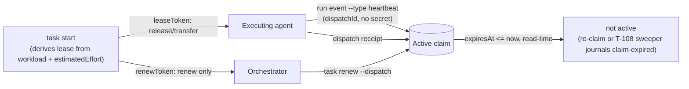
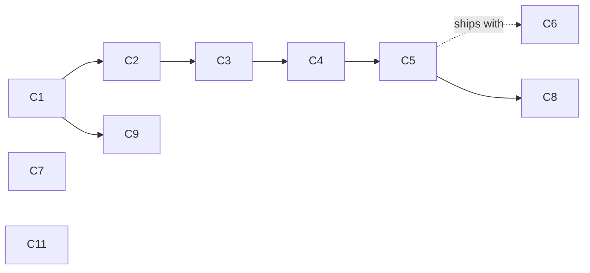

# Coordination v2 — leases, review lanes, and what `attempt` means

> **Status: design (T-124), not implemented.** Every change marked
> **PENDING OPERATOR APPROVAL** alters a public contract (a CLI flag, a
> protocol schema, or the observable semantics of an existing event) and must
> be approved before any implementation task is dispatched. This document
> decides direction; it writes no code and creates no board tasks.

Root cause R2 of the October 2026 agent-friction report — "rigid execution
model: one holder per claim, lease measured on the wall clock, token held only
by the holder, `attempt` used as a slice, no review role". R2 is the part of
MapCtx that survives the Option B question (see
[Option B and storage neutrality](#8-option-b-and-storage-neutrality)), so it
is the first thing worth fixing.

Sources: the friction report (22 frictions, 7 root causes), the earlier lease
RFC (ELA store, 280 tasks), and this repository's own store
(`9176b907-…`, read-only query on 2026-10-09).

---

## 1. Evidence

Measured in this repository's store, not estimated:

| Signal | Value | Reading |
| --- | --- | --- |
| `task.claimed` | 162 | — |
| `task.claim-renewed` | 26 events, 13 distinct claims | **8% of claims renewed at least once (13/162), not 16%** — 26 counts renewal *events*; several claims were renewed more than once, so the event count overstates how many claims ever got a renewal |
| `task.claim-expired` | 12 | journaled expiries |
| Claims in `state='active'` with `expiresAt` in the past | 9 (T-001…T-005, T-111…T-114, expired 2026-10-02) | ghosts, but not uniformly: T-001…T-005 (5) read `executionState=claimed` — a lie until the next claim on the same task touches it. T-111…T-114 (4) already read `executionState=completed` — the board calls the task done while the store still carries what looks like an open lock on it, the same lazy-expiry bug seen from the other side |
| Receipts spanning > 30 min (one full lease) | 44 of 104 (42%); 15 of 67 live, non-backfill receipts (22%) | the default lease is shorter than the work it covers |
| `dispatch.attempted` without a receipt | 62 of 166 (37%) | a dispatch stays valid long after execution stopped |
| `run.event-recorded` | **0** | the protocol already has `RunEvent.type = "heartbeat"`; nothing has ever emitted one |
| Dispatches by max attempt | 114×1, 3×2, 3×3, 2×4, 2×6, 1×7, 1×10 | the long chains are indistinguishable from genuine retries |

Three facts in the code set the hard boundaries of this design:

1. **`DEFAULT_LEASE_DURATION_MS = 30 * 60 * 1000`**
   (`packages/store/src/claims.ts:8`) and `leaseDurationMs` is **not exposed by
   the CLI** — not on `task claim`, `task start`, or `task renew`. Thirty
   minutes is not a default; it is the only value.
2. **One active claim per task is enforced in SQL**:
   `CREATE UNIQUE INDEX idx_resource_claim_active_task ON resource_claim_projection(task_id) WHERE state = 'active'`
   (`packages/store/src/schema.ts:117`). The reviewer's `active-claim-held` was
   not a policy choice that can be reasoned around; it is an index.
3. **`task_projection.execution_state` is a single scalar.** A task cannot be
   "running" and "under review" at the same time in that column.

And one bug independent of every option below: `getActiveClaimForTask`
(`projections.ts:389`) selects `state = 'active'` with **no expiry predicate**.
Expiry is lazy — only a later `claim`/`renew` on the *same* task journals
`task.claim-expired`. That is where the 9 ghosts come from.

---

## 2. Decision 1 — Lease renewal bound to the dispatch

**The problem.** Renewal requires `--claim <id> --token <leaseToken>`
(`mapctx-cli.ts:993`). The token is printed once, to whoever ran `task start`.
An orchestrator that dispatched the work holds the `dispatchId` but not the
token, so it cannot keep the lane alive; the executing agent must interrupt
itself every 20 minutes to do it by hand. It does not happen: 26 renewal
events across 162 claims, only 13 claims (8%) ever renewed at all (§1). The
field-friction report's account of leases expiring "four or more times during
one live T-124-class session" is **testimony, not an independently measured
figure in this store** — cited here as motivation, not evidence.

### Options

| # | Option | Cost | What it fixes | What it does not |
| --- | --- | --- | --- | --- |
| 1A | Longer fixed default (30 min → 4 h) + `--lease <duration>` | trivial | the common expiry | still holder-only renewal; a dead agent now blocks for 4 h instead of 30 min |
| 1B | **Derived `renewToken`**: `task start` prints a renew-only capability alongside `leaseToken`; renewal addressed by `(dispatchId, attempt)` | small | orchestrator can renew without gaining release authority | nothing about duration |
| 1C | **Liveness from run events**: expose `mapctx run event`; any run event (including `heartbeat`) extends the active claim | small–medium | renewal becomes a by-product of working, addressed by `dispatchId`, no secret | needs the agent to emit *something* at step boundaries |
| 1D | **Derive the default from planning data**: lease = f(`workload`, `estimatedEffort`) | small | the common case, with zero new ceremony | nothing about who may renew |
| 1E | Daemon heartbeat (background process renews while alive) | high | expiry | agents are turn-scoped processes, not supervisors; a wedged agent keeps renewing — liveness theater |

**1D deserves emphasis**: `appendTaskClaim` already *refuses to claim* an
executable task without both `workload` and a parseable `estimatedEffort`
(`claims.ts:52-75`), and `parseEstimatedEffortMs` already exists in
`@mapctx/protocol`. The inputs for a sensible lease are mandatory at claim time
and currently thrown away. A `Hard` / `2d` task receiving the same 30-minute
lease as a `Easy` / `30m` task is the bug.

### Recommendation

**1D + 1C + 1B, layered. Reject 1E. 1A only as the knob 1D computes.**

- **Default** lease = `clamp(parseEstimatedEffortMs(estimatedEffort) × 0.5, 30 min, 8 h)`,
  overridable by `--lease <duration>` and by `[coordination] defaultLease` /
  `maxLease` in `mapctx.toml`. The multiplier and the cap are operator-tunable;
  the point is that the lease is derived from the plan, not from a constant.
- **Liveness** from run events: expose the writer that already exists
  (`recordRunEvent`, `run.event-recorded`, `run_event_projection`) as
  `mapctx run event <dispatch-id> --type heartbeat|progress [--payload json]`,
  addressed by `dispatchId` alone — no token. An event only renews when **all**
  of: the dispatch's **latest** attempt is still open (no landed receipt), the
  caller's `attempt` matches that latest attempt exactly, and the matching
  claim is unexpired. A duplicate, a stale (lower) attempt, or an event against
  a `completed`/`failed`/`cancelled` attempt is accepted and journaled as a run
  event for the record but **never renews** — otherwise a late or replayed
  heartbeat from a superseded attempt could extend a different holder's lease.
  Accepted events extend the claim by the lease duration and journal
  `task.claim-renewed`. **No daemon**: the agent emits an event where it
  already pauses — after a test suite, between slices — the same moment it
  would have run `renew`.

  This path is intentionally secret-free, which is a trust decision, not an
  oversight: anyone who can reach the local CLI/store already has that
  trust level (§8 restates this — "local DB/journal readers are trusted, not
  a security boundary"), and the worst a spurious heartbeat can do is keep a
  lease alive longer, never seize or release it. Two things bound the damage
  of a wedged-but-still-heartbeating agent, since evidence-based liveness
  alone would otherwise renew forever: an **absolute ceiling of 24 h from the
  original `claimedAt`**, after which no renewal path — heartbeat or explicit
  — extends the claim, only a fresh `task start` (the existing reclaim path,
  verified live in this attempt: it already expires the stale claim and mints
  a new one atomically); and the attempt-chain warning (§4) catching the
  "keeps renewing, never finishes" pattern from the other side.
- **Explicit renewal** stays available and gains a dispatch address, but drops
  the earlier HMAC idea — recomputing `HMAC(leaseToken, …)` to verify a renewal
  still requires reading `leaseToken`, so it was never actually secretless, it
  just renamed the same dependency. Simpler and honest instead: `task
  start`/`task claim` mint **two independent random tokens** at claim time,
  stored together in `resource_claim_projection` and in the `task.claimed`
  payload, both scoped to `(dispatchId, attempt)` — `leaseToken` (release,
  transfer, and renewal) as today, plus a new `renewToken` (renewal only).
  `task renew --dispatch <id> --renew-token <token>` checks the presented
  token against the stored `renewToken` for the dispatch's latest open attempt
  by constant-time equality — a comparison, not a recomputation, so there is
  no algorithm to pin down and no secret the verifier needs to fetch from
  anywhere but the one row it already owns. An orchestrator holding
  `renewToken` can keep the lane alive but cannot `release` or transfer the
  claim, which still requires `leaseToken`. Capability split by **possession**,
  not by a derivation that quietly re-requires the thing it was meant to
  avoid.

  Output hygiene, because the problem was never only the formula: `task
  renew`'s response confirms the new `expiresAt` and does not echo
  `leaseToken`; the `active-claim-held` refusal (`claims.ts:93`,
  `mapctx-cli.ts:735-737`) prints `claimId`, `holder`, and `expiresAt` only —
  never `leaseToken` or `renewToken` — and `RenewResult` (`claims.ts:145-182`,
  printed at `mapctx-cli.ts:993-999`) is trimmed the same way. None of this
  claims confidentiality against a principal with direct DB or journal
  access — see §8 — only against unnecessary exposure through CLI
  output, logs, and messages that get relayed between agents.
- **Independently of all of the above**, fix read-time truth — but precisely,
  because the naive fix breaks reclaim. `claimTask`
  (`claims.ts:77-105`) already handles expiry correctly on the **admission**
  path: it calls `getActiveClaimForTask` to find the stale row, journals
  `task.claim-expired` for it, and only then inserts the replacement — all
  before the partial unique index (`schema.ts:117`) ever sees two `active`
  rows. We verified this live while writing this revision: reclaiming T-124's
  own attempt after its lease expired returned `"expiredPrevious":
  "<claimId>"` and succeeded in one call, no sweeper involved. Dispatch
  admission (`dispatch.ts:69-73`) also already rejects an expired lease. **The
  bug is narrower than the first draft of this doc claimed: it is stale truth
  on *read* paths that never go through admission** — `plan`, `task show`,
  and any display of `resource_claim_projection` keep reporting a ghost
  `active` until something re-claims that specific task. Filtering
  `getActiveClaimForTask` itself by expiry would "fix" that symptom by
  breaking admission: a filtered getter would stop seeing the stale row,
  skip journaling its expiry, and then the insert would hit the still-`active`
  row's unique-index entry and fail. So the fix is **two getters, not one**:
  `getActiveClaimForTask` (unfiltered — used only by the admission/reclaim
  path, which must see and expire the stale row before inserting) stays
  exactly as it is; a new `getLiveActiveClaim` (expiry-filtered) is what
  `plan`, `task show`, and every other pure-read caller use instead. The
  admission path's expiry-then-insert already happens atomically in one
  transaction — the new work is adding the filtered getter, routing every
  non-admission reader to it, and locking the behavior down with tests for
  the exact expiry boundary, reclaim with no sweeper involved, and two
  concurrent reclaim attempts on the same ghost.

### Impact

| Layer | Change | Approval |
| --- | --- | --- |
| Protocol | `task.claimed` payload gains `renewToken` — an independent random capability minted at claim time, not derived (additive; absent on the 162 existing events, which is fine, none is still `active`) | **PENDING OPERATOR APPROVAL** |
| Protocol | no new event type — `RunEvent`/`run.event-recorded` already exist | — |
| Store | `claims.ts` derives lease duration, mints `renewToken`, binds run-event renewal to the dispatch's latest open attempt, enforces the 24 h absolute ceiling; `projections.ts` adds `getLiveActiveClaim` alongside the unchanged `getActiveClaimForTask` | **PENDING** (observable semantics of an existing event; CLI output no longer echoes `leaseToken`/`renewToken` on refusal or renewal) |
| CLI | `--lease <duration>` on `task claim`/`task start`; `task renew --dispatch/--renew-token`; new `mapctx run event`; sanitized refusal/renew output | **PENDING OPERATOR APPROVAL** |
| Config | `[coordination] defaultLease`, `maxLease`, `leaseFactor` in `mapctx.toml` | **PENDING** |

**Data migration.** `resource_claim_projection` gains a `renew_token` column
(backfilled `NULL` for the 162 historical rows — none of them is still
`active`, so there is nothing to reclaim retroactively; a row only needs a
`renewToken` from the claim event onward). No index is altered by this
decision alone (the `exclusivity` index change belongs to §3). The 9
ghost active claims do **not** self-heal by this decision: they stop reading
as `active` on the new `getLiveActiveClaim` path the moment it ships, but
their rows stay `state='active'` in the table until something re-claims that
task — admission-time expiry, not a background sweep, is what actually
flips the row (see [T-108](#5-decision-4--the-fate-of-t-107-and-t-108) for
the sweeper that forces that touch for tasks nobody re-claims on their own).

**Compatibility break.** One, and it is intentional: a caller that today
receives `active-claim-held` from an *expired* claim will start succeeding.
That is the bug being fixed, but any automation that depends on the old
behaviour is affected. Longer default leases also mean a genuinely dead holder
blocks for longer — which is precisely why 1C (liveness evidence) is designed
in alongside the lease derivation here, not added later. The sweeper (T-108,
C9) is a different kind of dependency: it must land **after**, not alongside,
because it depends on the read-time fix (C1) to tell a true ghost from a
holder nobody has re-claimed yet (§6's waves place it last for that reason).

---

## 3. Decision 2 — Concurrent review dispatch

**The problem.** A reviewer ran `task start` on a task under implementation and
got `active-claim-held`. Independent review therefore happens entirely outside
MapCtx — this epic alone holds dozens of `t1xx-review-attemptN` artifacts that
the store has never heard of. The board cannot say a task was reviewed, by
whom, or how many attempts it took.

### Options

| # | Option | Mechanism | Verdict |
| --- | --- | --- | --- |
| 2A | `reviewing` executionState | add to `executionStateSchema` + `EXECUTION_TRANSITIONS` | **reject as the primary mechanism.** `execution_state` is one scalar describing *the task's* run, and review is a *second, concurrent* run. Encoding it as a state re-serializes exactly what we are trying to parallelize, and it collides with the journaled retry-admission resets in `dispatch.ts:79-103`. It also puts coordination truth inside `task_projection` — the row that migrates to the provider under Option B. Keep "has an open review dispatch" as a **derived read**, never stored state. |
| 2B | **Dispatch kind** | `Dispatch.kind: "implement" \| "review"`, default `implement` | **recommended.** The dispatch is already the unit of work, of attempts, and of receipts. A review dispatch gets its own `dispatchId`, its own attempt counter and its own receipt, so `evaluateRunReceipt` — which is scoped per `dispatchId` — keeps implement and review attempts from ever invalidating each other. That is the clean seam. |
| 2C | **Claims by role** | lease gains `exclusivity: "exclusive" \| "shared"` + `role`; index becomes `UNIQUE(task_id) WHERE state='active' AND exclusivity='exclusive'` | **recommended, additive to 2B.** Without it the review lane is invisible again — no holder, no lease, no liveness accounting, one layer deeper. Named `exclusivity`, not `mode`: `ResourceClaim.mode: "read" \| "write"` already exists in `packages/protocol/src/entities.ts:149-166` for the planner's file-level resource locking (`planner/src/index.ts:197`, which T-125 is actively changing) — same entity name, unrelated concept, different layer. Reusing `mode` here would collide in review and in anyone's mental model; it does not collide in the database, since the lease record (`packages/store/src/types.ts:87-97`) is a distinct table from the planner's resource claims. |

### Recommendation

**2B + 2C together; 2A only as a derived field in `plan` output.**

- `mapctx task start <id> --kind review` takes a **shared** claim and opens a
  **review** dispatch. It is never refused because an implement claim is held.
- `implement` keeps the exclusive claim and the `requireActiveClaim` admission
  it has today. A shared review claim never blocks implementation: review must
  not be able to stall the work it reviews.
- A **review receipt does not drive the task's execution or planning state.**
  It records the review outcome against its own dispatch. `completed` on a
  review dispatch must not move planning to `review` and must not touch
  `executionState`; promoting `review → done` or sending it back to
  `in-progress` stays an explicit orchestrator or operator decision. This needs
  `assertReceiptPlanningAdmission` (`projections.ts:1359`) and the guard in
  `dispatch.ts:276` to branch on `kind`.
- **This has to hold everywhere a claim or a dispatch currently assumes "one
  task, one lane", not only at receipt time.** A shared review claim is a
  second claim on a task that already has an exclusive implement claim —
  every applier that currently reasons from "this task's active claim" must
  become kind/role-aware, or releasing/expiring the *review* claim will reset
  the *implement* lane's `executionState` out from under a holder who is
  still working. Concretely: the claimed/released/expired appliers
  (`events.ts:237-269`), the dispatch applier (`events.ts:292-309`), dispatch
  admission and the retry-admission reset (`dispatch.ts:78-103`), and both
  receipt-transition paths (`dispatch.ts:288-305`, `projections.ts:866-909`)
  all branch on `role`/`kind` today as if there can only ever be one claim —
  each needs an explicit "mine to touch, or not" check. Test the
  interleavings directly, not just the happy path: review claim released or
  expired while the implement claim is still active; both receipt orders
  (review lands first, implement lands first); a review in flight against an
  implementation that then fails; and legacy (pre-`kind`) event replay, which
  must keep behaving as implement-only. **The review CLI (`--kind review`)
  ships only once this and C6 (review receipt admission) land together** —
  shipping 2B/2C's schema and claim before the lifecycle guards would open the
  review lane before the thing it's supposed to not break is actually
  protected.
- `plan` gains a derived `review: { open, attempts, lastOutcome }` per task.
  Nothing is stored that a projection cannot rebuild.
- **Forecast calibration stays implement-only.** `packages/forecast/src/
  store.ts:39-64,75-84` reads every receipt as a workload-duration sample
  with no `kind` filter; once review dispatches exist, a quick review
  receipt on a `Hard` task would be read as "`Hard` tasks finish fast,"
  corrupting exactly the estimate `estimatedEffort` now has to earn its keep
  for (§2). Review time and implementation time are different populations;
  the join excludes `kind != 'implement'` unconditionally, filed under C6
  alongside the planning/execution admission guard, since both are the same
  kind of leak — a review outcome reaching somewhere it shouldn't.

### Impact

| Layer | Change | Approval |
| --- | --- | --- |
| Protocol | `dispatchSchema` gains `kind` (default `implement`); `Dispatch.v1.json` regenerated | **PENDING OPERATOR APPROVAL** |
| Protocol | claim payloads gain `exclusivity` and `role` (absent = `exclusive`/`implement`) | **PENDING OPERATOR APPROVAL** |
| Store | `dispatch_projection` `ADD COLUMN kind`; `resource_claim_projection` `ADD COLUMN exclusivity, role`; both `NOT NULL` with a validated enum and an explicit backfill (not a bare default — see migration below); drop and recreate `idx_resource_claim_active_task` with the `exclusivity='exclusive'` predicate; `packages/store/src/types.ts:87-97` gains the new fields | **PENDING** |
| Store | `getActiveClaimForTask` splits into `getActiveExclusiveClaim` + `listActiveClaims`; receipt admission and the lifecycle appliers listed above branch on `kind`/`role` | **PENDING** (semantics of `run.receipt-recorded` and of claim release/expiry) |
| CLI | `task start --kind review`, `dispatch create --kind review`, review columns in `plan` | **PENDING OPERATOR APPROVAL** |

**Data migration.** Not the zero-touch backfill the first draft of this
document claimed. A plain `NULL`-reads-as-default column is exactly the
footgun this revision found and fixed for `renewToken` in §2 — reusing it
here for `exclusivity` is actively unsafe: if the new partial index's
predicate is `WHERE exclusivity='exclusive'`, a legacy row with
`exclusivity=NULL` does **not** match it and stops being protected by the
uniqueness constraint, even though the application layer still treats a
`NULL`-exclusivity claim as exclusive — a second, explicitly-`'exclusive'`
claim could then be inserted on the same task without a UNIQUE violation,
i.e. two effective exclusive claims. So the migration runs in order: (1)
`UPDATE resource_claim_projection SET exclusivity='exclusive',
role='implement'` for all 162 existing rows, (2) add the columns `NOT NULL
DEFAULT 'exclusive'`/`'implement'` with a `CHECK` enum, (3) only then drop
and recreate `idx_resource_claim_active_task` with the `exclusivity='exclusive'`
predicate — in that order, so the index is never rebuilt while a row could
still be `NULL`. `dispatch_projection.kind` gets the same treatment for
consistency (one migration pattern, not two different null-handling
philosophies), even though `kind` alone doesn't sit inside a unique index
today. Replay must apply the identical default (absent `kind`/`exclusivity`/
`role` on an old event → `implement`/`exclusive`/`implement`) so a database
rebuilt from the event log matches one that went through the live `UPDATE` —
otherwise replay and incremental migration diverge on exactly the rows this
fix exists to protect.

**Compatibility break.** None for readers that ignore unknown fields. One for
writers: a `completed` review receipt no longer carries planning to `review`.
That is new surface, not changed surface — no review dispatch exists today.

---

## 4. Decision 3 — Slices become subtasks; `attempt` means retry

**The problem.** T-211 was executed as slices S1/S2/S3 run as `attempt` 1, 2
and 3 of a single `dispatchId`. This is not merely untidy; it breaks three
mechanisms that are load-bearing:

1. **Receipts are lost.** `evaluateRunReceipt` rejects any receipt whose
   `attempt` is lower than the latest dispatched attempt as `stale-attempt`
   (`attempt-lifecycle.ts:65-68`). Once S2 is dispatched, S1's receipt is
   unacceptable — by design, because that rule exists to stop a late attempt
   from overwriting a newer one.
2. **Execution state is reset as if reopening unfinished work — not marked
   failed, and nothing is lost.** Dispatching a new attempt against a
   `completed` execution journals a reset to `unclaimed` with `source:
   "retry-admission"` (`dispatch.ts:79-103`). That is an admission patch, not
   a verdict: no receipt is deleted or overwritten, and the prior slice's
   `completed` receipt stays fully queryable. The actual problem is semantic,
   not data loss — every new slice's admission record reads as "this needed
   to be reopened," which is a false signal about work that in fact finished
   and simply had more work queued after it.
3. **Forecasting is poisoned.** `workloadAtDispatch` and `workloadAtReceipt`
   are frozen per attempt specifically to calibrate estimates for *a whole
   task* (T-071). A three-slice task teaches the model that `Hard` tasks need
   three attempts.

Observed chains of 10, 7, 6, 6, 4 and 4 attempts are indistinguishable from
genuine retries today.

### Options

| # | Option | Verdict |
| --- | --- | --- |
| 3A | Normative only — document "`attempt` = retry", update the skills | necessary but insufficient. Free, ships immediately, and will be ignored again whenever a task is too big and creating subtasks feels expensive. |
| 3B | **Subtask ergonomics + a warning** | **recommended.** Make the correct path the cheap one, and make the wrong one visible. |
| 3C | First-class `slice`/`step` field on `Dispatch` | **reject.** It builds a second hierarchy beside the task tree, which already has `parentTaskId` and `deriveSubIssueProgress`. Decisively: slices need their own **acceptance criteria**, which tasks have and dispatches never will. Modelling slices on the dispatch means a slice can never be independently accepted. |

### Recommendation

**3B, with 3A shipping first because it costs nothing.**

- `mapctx task split <task-id> --slice "S1 title:<effort>" --slice "S2
  title:<effort>"` creates child tasks inheriting `domains`, `role`, and the
  parent's `workload` class, with `parentTaskId` set to **the task being
  split** (the slices are its children, consistent with
  `deriveSubIssueProgress` already aggregating child progress upward). Three
  things this leaves undefined in the first draft, now pinned down:
  - **Effort is mandatory per slice, with no invented default.** Claim
    admission already refuses an executable task without a parseable
    `estimatedEffort` (`claims.ts:52-75`); `workload` class alone doesn't
    imply a duration, so `task split` surfaces that same refusal immediately
    if a `--slice` omits `:<effort>`, rather than dividing or copying the
    parent's estimate and inventing a number nobody actually judged.
  - **Acceptance is optional at split time, like any other task.** It has no
    special default and needs none: a task is claimable without acceptance
    criteria today (only `done` requires approved ones), so a slice follows
    the normal path — attach acceptance via `task acceptance revise` before
    anyone tries to finish it, whenever that happens to be.
  - **Dependency ordering defaults to none.** Slices are independent and
    claimable in any order unless the operator explicitly links them with
    `--depends-on` (the existing flag, pointed at sibling slice IDs) —
    imposing sequential order by default would just recreate the
    attempt-as-slice coupling this decision exists to break, one layer down.
  - **`task split` does not dispatch.** It creates the child tasks and stops;
    claiming and dispatching each slice stays an explicit, separate decision,
    same as for any task. (The first draft said each slice gets "its own
    dispatch" from `split` itself — that overstated it: `split` is a planning-
    tree operation, not an execution trigger.)
  One command still replaces "create, set workload, set estimatedEffort, set
  parent, link" per slice — the friction that made `attempt` look attractive
  — it now also forces the one input (`estimatedEffort`) that the old
  friction let agents skip.
- A **warning, never a refusal**, when a dispatch reaches `attempt >= 4` with
  no intervening `failed` or `blocked` receipt: the signature of slice abuse.
  Refusing would strand legitimate retry chains.
- Calibration **excludes `kind != 'implement'` receipts and any chain the
  `attempt >= 4` predicate flags, permanently, as a read-time join** — not a
  stored flag that later needs "classifying" or clearing. The first draft's
  "until classified" implied a status to resolve; there isn't one, because
  whether a long chain turned out to be legitimate retries or slice abuse,
  neither case makes it a clean one-task calibration sample, so there is
  nothing to reinstate. Review receipts need the same exclusion for the same
  reason (§3, §6) — both predicates belong in one shared helper that
  `dispatch.ts`'s warning and `packages/forecast/src/store.ts`'s calibration
  joins both call, rather than two copies of the same logic drifting apart.

### Impact

| Layer | Change | Approval |
| --- | --- | --- |
| Protocol | none | — |
| Store | `tasks.ts` gains the inheriting child-create path, effort-required validation per slice, and the attempt-chain predicate as a shared helper; `packages/forecast/src/store.ts:39-64,75-84` calls that helper to exclude flagged chains and non-`implement` receipts from calibration | **PENDING** (new warning in existing output; forecast calibration population changes) |
| CLI | `mapctx task split --slice "title:effort"`, `--depends-on` on slices, `--help` updated | **PENDING OPERATOR APPROVAL** |
| Skills / rules | `mapctx-traycer` and `mapctx-tasks` state the rule: `attempt` is a retry of the same contract; a new scope is a subtask | no approval needed (documentation) |

**Data migration.** None. Existing long chains stay exactly as they are; they
are flagged by the scan, never rewritten. **No compatibility break** — the
warning is additive and `task split` is new surface.

---

## 5. Decision 4 — The fate of T-107 and T-108

Both were created by the lease RFC. Both currently report
`planningState: backlog` with `executionState: completed`, which needs
explaining before deciding anything.

**Verified on 2026-10-09 (read-only store query).** Each has exactly one
dispatch with `executorKind: "history-scan"` and one `completed` receipt —
T-107 spanning 2026-09-13 → 09-15, T-108 spanning 2026-09-15 → 09-17, each with
a single changed file and `historySource: mixed`, `historyTier: measured`.
Meanwhile the current CLI has **no `executionState` in `plan` output** and **no
`stale` command at all**. Neither feature exists.

So the `completed` execution state on both tasks is a **mis-attributed
retroactive backfill** from `history scan --commit`, not delivered work. This is
itself an eighth data point for R2: a dispatch outlives its execution, and
nothing reconciles the two.

| Task | Decision | Reason |
| --- | --- | --- |
| **T-107** — `plan --show-execution` + `bulk-updated-timestamp` → info | **Keep, re-scoped; one half absorbed elsewhere.** Keep it as the coordination read-model task and widen it: claim `exclusivity`/`role`, open review dispatch, lease remaining, ghost flag. Move the `bulk-updated-timestamp` severity change to **T-127**, which already owns the R4/R7 CLI quick wins. | The diagnostic view stops being a nicety once shared claims and review dispatches exist — with two lanes per task, a reader cannot tell who holds what without it. The `validate` severity tweak has nothing to do with coordination and should not ride along. |
| **T-108** — `stale scan` | **Keep, narrowed.** Narrow it to the sweeper role: enumerate ghosts, journal `task.claim-expired`, and propose a planning target under `--commit`. Drop its acceptance line "heartbeat registered as follow-up: the scan's data decides whether a sweeper suffices" — **this document decides it** (§2: evidence-based liveness, no daemon). Drop any read-model overlap; that is T-107. Keep the historical T-101 link. | Longer derived leases (§2) make a dead holder block *longer*, so the sweeper is more necessary, not less. But its repair duty shrinks: once reads apply the expiry predicate, the ghost stops being load-bearing and the sweep becomes bookkeeping plus operator-approved planning repair. |
| Neither | **Not cancelled. Not absorbed into T-124.** | T-124 is a design document; it cannot absorb implementation. Both tasks' substance survives this design — their scope changed, their reason to exist did not. |

**Both need an honest execution state before re-dispatch.** No `reopen` is
required: planning is `backlog` (non-terminal), and `task start` handles the
rest — `appendTaskClaim` carries `backlog → ready → in-progress`, then
`appendDispatchAttempt` sees `executionState: completed` and journals the
retry-admission reset to `unclaimed` and on to `claimed`. The false *receipt*
should not be deleted: record a `history.correction-recorded` event against
each (the mechanism exists — 29 corrections already in the journal) so the
backfill is contradicted in the audit trail rather than erased.
**PENDING OPERATOR APPROVAL** — it writes two correction events to the shared
store.

---

## 6. Proposed implementation tasks

Listed, **not created**. Effort is agent-active hours. IDs are assigned at
creation; T-125…T-129 are taken by this epic's other lanes.

| # | Title | `filesAffected` | Workload | Effort | Approval |
| --- | --- | --- | --- | --- | --- |
| C1 | Read-time lease truth: `getLiveActiveClaim` alongside unchanged `getActiveClaimForTask` | `packages/store/src/projections.ts`, `packages/store/src/claims.ts` | Easy | 4 h | **PENDING OPERATOR APPROVAL** — changes observed behaviour of `active-claim-held` on an expired claim |
| C2 | Lease duration derived from `workload`/`estimatedEffort`, `--lease` override, `[coordination]` config | `packages/store/src/claims.ts`, `packages/store/src/config.ts`, `packages/sync-engine/src/mapctx-cli.ts` | Normal | 5 h | **PENDING** |
| C3 | `renewToken`: independent capability minted at claim time, equality-checked, bound to the dispatch's latest open attempt; sanitized refusal/renew output | `packages/store/src/claims.ts`, `packages/store/src/events.ts`, `packages/sync-engine/src/mapctx-cli.ts` | Normal | 7 h | **PENDING** |
| C4 | `mapctx run event` CLI; accepted events bound to latest-open-attempt extend the claim; 24 h absolute ceiling | `packages/sync-engine/src/mapctx-cli.ts`, `packages/store/src/dispatch.ts`, `packages/store/src/claims.ts` | Normal | 7 h | **PENDING** |
| C5 | Dispatch `kind` + shared review claims: schema, `NOT NULL`+backfill migration, index swap, admission, and every kind/role-aware applier (§3) | `packages/protocol/src/entities.ts`, `packages/protocol/schemas/Dispatch.v1.json`, `packages/store/src/schema.ts`, `claims.ts`, `dispatch.ts`, `start.ts`, `events.ts`, `projections.ts`, `types.ts`, `packages/sync-engine/src/mapctx-cli.ts` | Hard | 16 h | **PENDING** |
| C6 | Review receipt admission (never drives planning/execution) + forecast calibration excludes `kind != 'implement'` | `packages/store/src/projections.ts`, `packages/store/src/dispatch.ts`, `packages/forecast/src/store.ts` | Normal | 8 h | **PENDING** |
| C7 | `mapctx task split` (mandatory per-slice effort, optional acceptance, no auto-dispatch) + attempt-chain warning as a shared, forecast-reachable predicate + normative `attempt` rule | `packages/sync-engine/src/mapctx-cli.ts`, `packages/store/src/tasks.ts`, `packages/forecast/src/store.ts`, `rules/`, skills | Normal | 8 h | **PENDING OPERATOR APPROVAL** |
| C8 | T-107 re-scoped: `plan --show-execution` with lane detail | `packages/sync-engine/src/mapctx-cli.ts`, `packages/store/src/projections.ts` | Normal | 5 h | **PENDING** |
| C9 | T-108 narrowed: `stale scan --dry-run` / `--commit` sweeper | `packages/sync-engine/src/mapctx-cli.ts`, `packages/store/src/claims.ts`, `packages/store/src/projections.ts` | Hard | 9 h | **PENDING** |
| C10 | `ClaimStore` port: extract exclusivity behind compare-and-swap | `packages/store/src/claims.ts`, new `packages/store/src/claim-store.ts` | Normal | 6 h | internal seam; **conditional on ADR 0005** |
| C11 | Skills, rules and docs: lease, heartbeat, review lane, `attempt` | `rules/`, `mapctx-traycer`, `mapctx-tasks`, `docs/` | Easy | 2 h | documentation |

Every task above carries tests; "tests" is dropped from `filesAffected` in
favour of naming what each task's tests must actually cover, since generic
"tests" is exactly the kind of unverifiable claim this revision exists to
stop making:

| # | Key tests | CLI surface touched |
| --- | --- | --- |
| C1 | exact expiry boundary; reclaim with no sweeper involved; two concurrent reclaims on the same ghost | none (internal getters only) |
| C2 | clamp boundaries (30 min / 8 h); `--lease` override precedence over config over derived default | `--help` for `task claim`/`task start` |
| C3 | constant-time compare; duplicate/replayed renew is idempotent; a renew against a superseded attempt is rejected; refusal/renew output contains no token | `--help` for `task renew` |
| C4 | duplicate, stale-attempt, and closed-dispatch events are journaled but never renew; 24 h ceiling blocks renewal even with live heartbeats | `--help` for new `run event` |
| C5 | legacy-row migration (`NULL` never reaches the live index); old writers omitting `kind`/`exclusivity`; full event-log replay matches live migration; two-process contention for the exclusive slot; concurrent shared+exclusive admission | `--help` for `task start --kind` |
| C6 | shared review claim released/expired while implement claim stays active; both receipt orders; implementation fails while review is open; legacy (pre-`kind`) replay stays implement-only; forecast query excludes a seeded review receipt | none |
| C7 | split refuses a slice missing effort; split never creates a dispatch; attempt-chain warning fires at 4 without refusing; forecast query excludes a seeded flagged chain | `--help` for `task split` |
| C8 | lane detail matches a live shared-claim fixture | `--help` for `plan --show-execution` |
| C9 | ghost detected pre-C1-fix state is not re-flagged post-fix as a false positive | `--help` for `stale scan` |

**Total ≈ 77 h** agent-active (71 h excluding the Option-B-conditional C10,
counting C11) — up from an uncorrected 63 h/53 h in the first draft, mostly
in C5 (full-lifecycle kind/role-awareness, §3) and C3/C4/C6/C7 (the renewal
redesign, §2, and the forecast/split specifics, §4/§6). Separately, the
first draft's own arithmetic was wrong even before these additions: 63 h
minus C10's 6 h is 57 h, not the "53 h" it stated.

**Suggested waves**, with the dependency this draft previously left
ambiguous now resolved explicitly:

- **C1 first and alone** — cheapest change, and it makes every later test
  assert against honest state.
- **C2 → C3 → C4, serialized, not two-parallel-plus-one-overlapping as the
  first draft claimed.** All three touch `claims.ts` (and C3/C4 both also
  touch `mapctx-cli.ts`); "C4's CLI work can overlap" was wrong — C4's
  `filesAffected` already listed `claims.ts`.
- **C5, then C6 landing in the same wave as C5's tail, not a separate later
  wave** — the review CLI must not be reachable (§3) until the kind/role-
  aware appliers (C5) and the receipt-admission guard (C6) are both in,
  so they are planned, reviewed, and merged as one unit even though they are
  two tasks for estimation purposes.
- **C8 depends on C5** — it reads lane detail (`exclusivity`/`role`,
  review-dispatch state) that does not exist before C5 ships; the first
  draft left this dependency unstated.
- **C7 and C11 are independent of all of the above** and can run in
  parallel at any point.
- **C9 last** — it depends on C1 (a sweeper written against stale reads
  would encode a ghost as normal) and, practically, on the full lease
  package (C1–C4), since "has nobody renewed or heartbeated this" is only a
  meaningful question once renewal and heartbeats exist to have failed to
  happen. This is a correction, not a new constraint: an earlier version of
  this document said the sweeper ships "as part of the same package" as the
  lease work, which read as *simultaneous*; the actual constraint is
  *sequential* — C9 depends on C1 (and in practice the rest of the lease
  package), full stop, resolved in C9's favor over any "same package"
  reading.
- **C10 only if ADR 0005 adopts Option B.**

---

## 7. Open questions answered, and one left open

The friction report closed with three questions. Two are settled here:

- **Does the heartbeat need a live process (daemon)?** No. Liveness is inferred
  from events the agent already has reason to emit at step boundaries, through
  a protocol path that already exists (`RunEvent.type = "heartbeat"`,
  `run.event-recorded`, `run_event_projection`) and has never been used — zero
  rows. A daemon would also renew for a wedged agent, which is worse than no
  signal.
- **Can concurrent review be its own `executionState` (`reviewing`), or only a
  dispatch kind?** Dispatch kind. `execution_state` is a single scalar
  describing the task's own run; review is a concurrent second run, and storing
  it on the task row would both re-serialize the lanes and put coordination
  truth in the row that migrates to the provider under Option B.

The third — **redaction scope and who may redact** — belongs to root cause R5
and task T-126, and is deliberately untouched here.

Still open, for the operator:

- The lease factor and cap (`estimatedEffort × 0.5`, clamped to 30 min…8 h) are
  a first guess. They should be re-derived from receipt durations once C1 makes
  the data honest.
- Should a shared review claim expire on the same schedule as an implement
  claim? A reviewer idle for hours is less harmful than a stalled implementer,
  which argues for a longer or non-expiring review lease.

---

## 8. Option B and storage neutrality

Coordination stays in MapCtx even if task authority moves to a provider
(the Option B study is [T-123](../../tasks/T-123.md); the store map classifies
claims, dispatch and receipts as **M — stays in MapCtx**). This design must
therefore not assume SQLite owns the task forever. Three consequences, all
already reflected in the recommendations above:

1. **Nothing coordination-related is stored on the task row.** This is the
   decisive argument against a `reviewing` `executionState` (§3) — correcting
   an overstatement in this document's own earlier draft: it is **not** the
   whole `task_projection` that becomes a read-only provider cache under
   Option B, only the provider-owned planning fields (title, assignee, and
   the like). `execution_state` and MapCtx's other intelligence fields
   (claims, dispatches, receipts, forecasting) stay MapCtx-owned either way —
   see the store-map artifact's field-by-field split. A `reviewing`
   `executionState` would still be wrong even restricted to the
   MapCtx-owned fields, for the reason already given: it is one scalar
   trying to describe two concurrent runs.
2. **Exclusivity must be expressible as a compare-and-swap on one record**, not
   as a SQL partial unique index. Today's safety comes from `BEGIN IMMEDIATE`
   plus `idx_resource_claim_active_task` (`claims.ts:22-28`). Under a git-ref
   CAS — one ref per task holding a small JSON claim set, updated with an
   expected old OID — the same invariant holds without SQLite. C10 extracts
   that port. Caveat worth naming: shared review claims make that record
   multi-writer, so CAS retries increase. Acceptable, because review claims are
   rare relative to implement claims.
3. **Renewal must not require the renewing party to hold the release
   capability.** `leaseToken` (release/transfer) and `renewToken` (renew-only)
   are independent capabilities minted together at claim time and scoped to
   `(dispatchId, attempt)` (§2); `task renew` checks the presented token
   against the stored value for that attempt by equality, never by
   recomputing a secret — a check that works the same way whether the stored
   value lives in a SQL row or a git-ref CAS record. This buys something
   narrower than "secretless", stated plainly rather than assumed: a store
   reader — a local DB connection today, a clone of the CAS ref tomorrow —
   already sees every token verbatim, same as every other field; **local
   DB/journal readers are trusted, not a security boundary**, and that stays
   true under Option B. What this design actually protects is (a) keeping
   `leaseToken` out of CLI output/logs beyond the one process that received
   it, and (b) keeping a `dispatchId` — not secret, visible to any
   orchestrator — from being enough on its own to acquire release/transfer
   rights. Concretely for a git-ref CAS backend: `leaseToken` is handed to the
   claiming process out-of-band (CLI stdout) and never committed to the ref;
   the ref carries a hash of it (recomputed and compared for `release`/
   `transfer`) plus the plain `renewToken` (meant to be read and compared, not
   hidden). That is the "non-secret verifier" this decision commits to instead
   of the HMAC-over-a-secret idea §2 started with and then dropped.

---

## 9. How we would know it worked

Re-run §1's queries after the lease package (C1–C4) lands:

| Metric | Today | Target |
| --- | --- | --- |
| Claims renewed at least once | 8% (13/162) | > 80% of claims outliving one lease, via run events |
| Claims `active` with past `expiresAt` on the live-read path | 9 | 0 on any read path |
| Dispatches with a `task.claim-expired` journaled while still open (no receipt landed yet) | not separately tracked today — the closest proxy is the 15-of-67 live receipts exceeding one lease span, which conflates renewed-and-fine with actually-gapped | ~0 — this is the metric that measures the defect (a real coordination gap during live execution) instead of the proxy (receipt duration vs. one lease), which has both false positives (continuously renewed long receipts) and false negatives (a short receipt that still had a mid-run expiry blip) |
| `dispatch.attempted` with no receipt | 37% (62/166) | falling, and every remaining one visible in `stale scan` |
| `run.event-recorded` | 0 | non-zero per long-running dispatch |
| Review attempts recorded in the store | 0 (all in Traycer artifacts) | one review dispatch per reviewed task |
| Dispatch chains with `attempt >= 4` and no failure receipt | 6 | 0 new ones |
