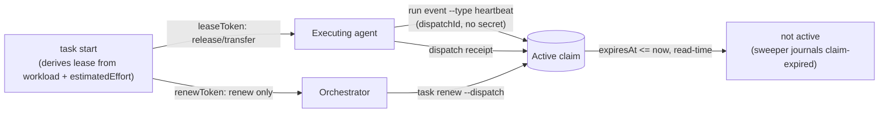

# Coordination v2 — leases, review lanes, and what `attempt` means

> **Status: design (T-124), not implemented.** Every change marked
> **PENDING OPERATOR APPROVAL** alters a public contract (a CLI flag, a
> protocol schema, or the observable semantics of an existing event) and must
> be approved before any implementation task is dispatched. This document
> decides direction; it writes no code and creates no board tasks.

Root cause R2 of the October 2026 agent-friction report — "rigid execution
model: one holder per claim, lease measured on the wall clock, token held only
by the holder, `attempt` used as a slice, no review role". R2 is the part of
MapCtx that survives the Option B question (see
[Option B and storage neutrality](#8-option-b-and-storage-neutrality)), so it
is the first thing worth fixing.

Sources: the friction report (22 frictions, 7 root causes), the earlier lease
RFC (ELA store, 280 tasks), and this repository's own store
(`9176b907-…`, read-only query on 2026-10-09).

---

## 1. Evidence

Measured in this repository's store, not estimated:

| Signal | Value | Reading |
| --- | --- | --- |
| `task.claimed` | 162 | — |
| `task.claim-renewed` | 26 | 16% of claims ever renewed once |
| `task.claim-expired` | 12 | journaled expiries |
| Claims in `state='active'` with `expiresAt` in the past | 9 (T-001…T-005, T-111…T-114, expired 2026-10-02) | ghosts: `executionState=claimed` is a lie until the next claim on the same task touches it |
| Receipts spanning > 30 min (one full lease) | 44 of 104 (42%); 15 of 67 live, non-backfill receipts (22%) | the default lease is shorter than the work it covers |
| `dispatch.attempted` without a receipt | 62 of 166 (37%) | a dispatch stays valid long after execution stopped |
| `run.event-recorded` | **0** | the protocol already has `RunEvent.type = "heartbeat"`; nothing has ever emitted one |
| Dispatches by max attempt | 114×1, 3×2, 3×3, 2×4, 2×6, 1×7, 1×10 | the long chains are indistinguishable from genuine retries |

Three facts in the code set the hard boundaries of this design:

1. **`DEFAULT_LEASE_DURATION_MS = 30 * 60 * 1000`**
   (`packages/store/src/claims.ts:8`) and `leaseDurationMs` is **not exposed by
   the CLI** — not on `task claim`, `task start`, or `task renew`. Thirty
   minutes is not a default; it is the only value.
2. **One active claim per task is enforced in SQL**:
   `CREATE UNIQUE INDEX idx_resource_claim_active_task ON resource_claim_projection(task_id) WHERE state = 'active'`
   (`packages/store/src/schema.ts:117`). The reviewer's `active-claim-held` was
   not a policy choice that can be reasoned around; it is an index.
3. **`task_projection.execution_state` is a single scalar.** A task cannot be
   "running" and "under review" at the same time in that column.

And one bug independent of every option below: `getActiveClaimForTask`
(`projections.ts:389`) selects `state = 'active'` with **no expiry predicate**.
Expiry is lazy — only a later `claim`/`renew` on the *same* task journals
`task.claim-expired`. That is where the 9 ghosts come from.

---

## 2. Decision 1 — Lease renewal bound to the dispatch

**The problem.** Renewal requires `--claim <id> --token <leaseToken>`
(`mapctx-cli.ts:993`). The token is printed once, to whoever ran `task start`.
An orchestrator that dispatched the work holds the `dispatchId` but not the
token, so it cannot keep the lane alive; the executing agent must interrupt
itself every 20 minutes to do it by hand. It does not happen: 26 renews across
162 claims. Leases expired four or more times during one live T-124-class
session.

### Options

| # | Option | Cost | What it fixes | What it does not |
| --- | --- | --- | --- | --- |
| 1A | Longer fixed default (30 min → 4 h) + `--lease <duration>` | trivial | the common expiry | still holder-only renewal; a dead agent now blocks for 4 h instead of 30 min |
| 1B | **Derived `renewToken`**: `task start` prints a renew-only capability alongside `leaseToken`; renewal addressed by `(dispatchId, attempt)` | small | orchestrator can renew without gaining release authority | nothing about duration |
| 1C | **Liveness from run events**: expose `mapctx run event`; any run event (including `heartbeat`) extends the active claim | small–medium | renewal becomes a by-product of working, addressed by `dispatchId`, no secret | needs the agent to emit *something* at step boundaries |
| 1D | **Derive the default from planning data**: lease = f(`workload`, `estimatedEffort`) | small | the common case, with zero new ceremony | nothing about who may renew |
| 1E | Daemon heartbeat (background process renews while alive) | high | expiry | agents are turn-scoped processes, not supervisors; a wedged agent keeps renewing — liveness theater |

**1D deserves emphasis**: `appendTaskClaim` already *refuses to claim* an
executable task without both `workload` and a parseable `estimatedEffort`
(`claims.ts:52-75`), and `parseEstimatedEffortMs` already exists in
`@mapctx/protocol`. The inputs for a sensible lease are mandatory at claim time
and currently thrown away. A `Hard` / `2d` task receiving the same 30-minute
lease as a `Easy` / `30m` task is the bug.

### Recommendation

**1D + 1C + 1B, layered. Reject 1E. 1A only as the knob 1D computes.**

- **Default** lease = `clamp(parseEstimatedEffortMs(estimatedEffort) × 0.5, 30 min, 8 h)`,
  overridable by `--lease <duration>` and by `[coordination] defaultLease` /
  `maxLease` in `mapctx.toml`. The multiplier and the cap are operator-tunable;
  the point is that the lease is derived from the plan, not from a constant.
- **Liveness** from run events: expose the writer that already exists
  (`recordRunEvent`, `run.event-recorded`, `run_event_projection`) as
  `mapctx run event <dispatch-id> --type heartbeat|progress [--payload json]`.
  Any accepted run event extends the task's active claim by the lease duration
  and journals `task.claim-renewed`. **No daemon**: the agent emits an event
  where it already pauses — after a test suite, between slices — which is the
  same moment it would have run `renew`, but addressed by `dispatchId` and
  requiring no secret.
- **Explicit renewal** stays available and gains a dispatch address:
  `task renew --dispatch <id> --renew-token <token>`, where
  `renewToken = HMAC(leaseToken, dispatchId + "|" + attempt)`. The orchestrator
  receives `renewToken` at `task start` and can keep the lane alive; it cannot
  `release` or transfer the claim, because that still requires `leaseToken`.
  Capability split, not a weakened lease.
- **Independently of all of the above**, fix read-time truth: every *decision*
  path (`getActiveClaimForTask`, dispatch admission, `plan`) must treat
  `expiresAt <= now` as not-active. Lazy *journaling* of `claim-expired` can
  stay — the event is a historical fact and a sweeper can write it later (see
  [T-108](#5-decision-4--the-fate-of-t-107-and-t-108)) — but no reader may call
  an expired lease `active`.

### Impact

| Layer | Change | Approval |
| --- | --- | --- |
| Protocol | `task.claimed` payload gains `renewToken` (additive; absent on the 162 existing events, derivable on read) | **PENDING OPERATOR APPROVAL** |
| Protocol | no new event type — `RunEvent`/`run.event-recorded` already exist | — |
| Store | `claims.ts` derives duration, verifies `renewToken`, extends lease on a run event; `projections.ts` applies the expiry predicate | **PENDING** (observable semantics of an existing event) |
| CLI | `--lease <duration>` on `task claim`/`task start`; `task renew --dispatch/--renew-token`; new `mapctx run event` | **PENDING OPERATOR APPROVAL** |
| Config | `[coordination] defaultLease`, `maxLease`, `leaseFactor` in `mapctx.toml` | **PENDING** |

**Data migration.** None required. `renewToken` is derived, not stored, so the
162 historical claim rows need no backfill. The 9 ghost active claims stop
reading as active the moment the predicate lands; a one-time sweep journals
their `task.claim-expired` for the audit trail. No table or index is altered.

**Compatibility break.** One, and it is intentional: a caller that today
receives `active-claim-held` from an *expired* claim will start succeeding.
That is the bug being fixed, but any automation that depends on the old
behaviour is affected. Longer default leases also mean a genuinely dead holder
blocks for longer — which is precisely why 1C (liveness evidence) and a sweeper
are part of the same package, not follow-ups.

---

## 3. Decision 2 — Concurrent review dispatch

**The problem.** A reviewer ran `task start` on a task under implementation and
got `active-claim-held`. Independent review therefore happens entirely outside
MapCtx — this epic alone holds dozens of `t1xx-review-attemptN` artifacts that
the store has never heard of. The board cannot say a task was reviewed, by
whom, or how many attempts it took.

### Options

| # | Option | Mechanism | Verdict |
| --- | --- | --- | --- |
| 2A | `reviewing` executionState | add to `executionStateSchema` + `EXECUTION_TRANSITIONS` | **reject as the primary mechanism.** `execution_state` is one scalar describing *the task's* run, and review is a *second, concurrent* run. Encoding it as a state re-serializes exactly what we are trying to parallelize, and it collides with the journaled retry-admission resets in `dispatch.ts:79-103`. It also puts coordination truth inside `task_projection` — the row that migrates to the provider under Option B. Keep "has an open review dispatch" as a **derived read**, never stored state. |
| 2B | **Dispatch kind** | `Dispatch.kind: "implement" \| "review"`, default `implement` | **recommended.** The dispatch is already the unit of work, of attempts, and of receipts. A review dispatch gets its own `dispatchId`, its own attempt counter and its own receipt, so `evaluateRunReceipt` — which is scoped per `dispatchId` — keeps implement and review attempts from ever invalidating each other. That is the clean seam. |
| 2C | **Claims by role** | `ResourceClaim.mode: "exclusive" \| "shared"` + `role`; index becomes `UNIQUE(task_id) WHERE state='active' AND mode='exclusive'` | **recommended, additive to 2B.** Without it the review lane is invisible again — no holder, no lease, no liveness accounting, one layer deeper. |

### Recommendation

**2B + 2C together; 2A only as a derived field in `plan` output.**

- `mapctx task start <id> --kind review` takes a **shared** claim and opens a
  **review** dispatch. It is never refused because an implement claim is held.
- `implement` keeps the exclusive claim and the `requireActiveClaim` admission
  it has today. A shared review claim never blocks implementation: review must
  not be able to stall the work it reviews.
- A **review receipt does not drive the task's execution or planning state.**
  It records the review outcome against its own dispatch. `completed` on a
  review dispatch must not move planning to `review` and must not touch
  `executionState`; promoting `review → done` or sending it back to
  `in-progress` stays an explicit orchestrator or operator decision. This needs
  `assertReceiptPlanningAdmission` (`projections.ts:1359`) and the guard in
  `dispatch.ts:276` to branch on `kind`.
- `plan` gains a derived `review: { open, attempts, lastOutcome }` per task.
  Nothing is stored that a projection cannot rebuild.

### Impact

| Layer | Change | Approval |
| --- | --- | --- |
| Protocol | `dispatchSchema` gains `kind` (default `implement`); `Dispatch.v1.json` regenerated | **PENDING OPERATOR APPROVAL** |
| Protocol | claim payloads gain `mode` and `role` (absent = `exclusive`/`implement`) | **PENDING OPERATOR APPROVAL** |
| Store | `dispatch_projection` `ADD COLUMN kind`; `resource_claim_projection` `ADD COLUMN mode, role`; drop and recreate `idx_resource_claim_active_task` with the `mode='exclusive'` predicate | **PENDING** |
| Store | `getActiveClaimForTask` splits into `getActiveExclusiveClaim` + `listActiveClaims`; receipt admission branches on `kind` | **PENDING** (semantics of `run.receipt-recorded`) |
| CLI | `task start --kind review`, `dispatch create --kind review`, review columns in `plan` | **PENDING OPERATOR APPROVAL** |

**Data migration.** Additive and cheap. The 166 existing `dispatch_projection`
rows read `NULL kind` as `implement`; the 162 claim rows read `NULL mode` as
`exclusive`. The index swap is a drop-and-create on a partial index — no data
rewrite, and the new predicate is strictly weaker, so no existing row can
violate it. Replay of the ~1 295 historical events is unaffected because absent
fields default to today's behaviour.

**Compatibility break.** None for readers that ignore unknown fields. One for
writers: a `completed` review receipt no longer carries planning to `review`.
That is new surface, not changed surface — no review dispatch exists today.

---

## 4. Decision 3 — Slices become subtasks; `attempt` means retry

**The problem.** T-211 was executed as slices S1/S2/S3 run as `attempt` 1, 2
and 3 of a single `dispatchId`. This is not merely untidy; it breaks three
mechanisms that are load-bearing:

1. **Receipts are lost.** `evaluateRunReceipt` rejects any receipt whose
   `attempt` is lower than the latest dispatched attempt as `stale-attempt`
   (`attempt-lifecycle.ts:65-68`). Once S2 is dispatched, S1's receipt is
   unacceptable — by design, because that rule exists to stop a late attempt
   from overwriting a newer one.
2. **Execution state is rewritten as failure.** Dispatching a new attempt
   against a `completed` execution journals a reset to `unclaimed` with
   `source: "retry-admission"` (`dispatch.ts:79-103`). Every new slice records
   the previous slice as something that needed re-opening.
3. **Forecasting is poisoned.** `workloadAtDispatch` and `workloadAtReceipt`
   are frozen per attempt specifically to calibrate estimates for *a whole
   task* (T-071). A three-slice task teaches the model that `Hard` tasks need
   three attempts.

Observed chains of 10, 7, 6, 6, 4 and 4 attempts are indistinguishable from
genuine retries today.

### Options

| # | Option | Verdict |
| --- | --- | --- |
| 3A | Normative only — document "`attempt` = retry", update the skills | necessary but insufficient. Free, ships immediately, and will be ignored again whenever a task is too big and creating subtasks feels expensive. |
| 3B | **Subtask ergonomics + a warning** | **recommended.** Make the correct path the cheap one, and make the wrong one visible. |
| 3C | First-class `slice`/`step` field on `Dispatch` | **reject.** It builds a second hierarchy beside the task tree, which already has `parentTaskId` and `deriveSubIssueProgress`. Decisively: slices need their own **acceptance criteria**, which tasks have and dispatches never will. Modelling slices on the dispatch means a slice can never be independently accepted. |

### Recommendation

**3B, with 3A shipping first because it costs nothing.**

- `mapctx task split <task-id> --slice "S1 title" --slice "S2 title"` creates
  child tasks inheriting `domains`, `role`, `workload` class and
  `parentTaskId`, each with its own dispatch, its own acceptance and its own
  receipt. One command replaces "create, set workload, set estimatedEffort, set
  parent, link" per slice — the friction that made `attempt` look attractive.
- A **warning, never a refusal**, when a dispatch reaches `attempt >= 4` with
  no intervening `failed` or `blocked` receipt: the signature of slice abuse.
  Refusing would strand legitimate retry chains.
- Calibration **excludes** flagged chains until classified, the same discipline
  `historyTier` already applies to inferred data.

### Impact

| Layer | Change | Approval |
| --- | --- | --- |
| Protocol | none | — |
| Store | `tasks.ts` gains the inheriting child-create path; attempt-chain predicate for the warning | **PENDING** (new warning in existing output) |
| CLI | `mapctx task split` | **PENDING OPERATOR APPROVAL** |
| Skills / rules | `mapctx-traycer` and `mapctx-tasks` state the rule: `attempt` is a retry of the same contract; a new scope is a subtask | no approval needed (documentation) |

**Data migration.** None. Existing long chains stay exactly as they are; they
are flagged by the scan, never rewritten. **No compatibility break** — the
warning is additive and `task split` is new surface.

---

## 5. Decision 4 — The fate of T-107 and T-108

Both were created by the lease RFC. Both currently report
`planningState: backlog` with `executionState: completed`, which needs
explaining before deciding anything.

**Verified on 2026-10-09 (read-only store query).** Each has exactly one
dispatch with `executorKind: "history-scan"` and one `completed` receipt —
T-107 spanning 2026-09-13 → 09-15, T-108 spanning 2026-09-15 → 09-17, each with
a single changed file and `historySource: mixed`, `historyTier: measured`.
Meanwhile the current CLI has **no `executionState` in `plan` output** and **no
`stale` command at all**. Neither feature exists.

So the `completed` execution state on both tasks is a **mis-attributed
retroactive backfill** from `history scan --commit`, not delivered work. This is
itself an eighth data point for R2: a dispatch outlives its execution, and
nothing reconciles the two.

| Task | Decision | Reason |
| --- | --- | --- |
| **T-107** — `plan --show-execution` + `bulk-updated-timestamp` → info | **Keep, re-scoped; one half absorbed elsewhere.** Keep it as the coordination read-model task and widen it: claim `mode`/`role`, open review dispatch, lease remaining, ghost flag. Move the `bulk-updated-timestamp` severity change to **T-127**, which already owns the R4/R7 CLI quick wins. | The diagnostic view stops being a nicety once shared claims and review dispatches exist — with two lanes per task, a reader cannot tell who holds what without it. The `validate` severity tweak has nothing to do with coordination and should not ride along. |
| **T-108** — `stale scan` | **Keep, narrowed.** Narrow it to the sweeper role: enumerate ghosts, journal `task.claim-expired`, and propose a planning target under `--commit`. Drop its acceptance line "heartbeat registered as follow-up: the scan's data decides whether a sweeper suffices" — **this document decides it** (§2: evidence-based liveness, no daemon). Drop any read-model overlap; that is T-107. Keep the historical T-101 link. | Longer derived leases (§2) make a dead holder block *longer*, so the sweeper is more necessary, not less. But its repair duty shrinks: once reads apply the expiry predicate, the ghost stops being load-bearing and the sweep becomes bookkeeping plus operator-approved planning repair. |
| Neither | **Not cancelled. Not absorbed into T-124.** | T-124 is a design document; it cannot absorb implementation. Both tasks' substance survives this design — their scope changed, their reason to exist did not. |

**Both need an honest execution state before re-dispatch.** No `reopen` is
required: planning is `backlog` (non-terminal), and `task start` handles the
rest — `appendTaskClaim` carries `backlog → ready → in-progress`, then
`appendDispatchAttempt` sees `executionState: completed` and journals the
retry-admission reset to `unclaimed` and on to `claimed`. The false *receipt*
should not be deleted: record a `history.correction-recorded` event against
each (the mechanism exists — 29 corrections already in the journal) so the
backfill is contradicted in the audit trail rather than erased.
**PENDING OPERATOR APPROVAL** — it writes two correction events to the shared
store.

---

## 6. Proposed implementation tasks

Listed, **not created**. Effort is agent-active hours. IDs are assigned at
creation; T-125…T-129 are taken by this epic's other lanes.

| # | Title | `filesAffected` | Workload | Effort | Approval |
| --- | --- | --- | --- | --- | --- |
| C1 | Read-time lease truth: expiry predicate on every decision path | `packages/store/src/projections.ts`, `packages/store/src/claims.ts`, tests | Easy | 3 h | behaviour correction; no new surface |
| C2 | Lease duration derived from `workload`/`estimatedEffort`, `--lease` override, `[coordination]` config | `packages/store/src/claims.ts`, `packages/store/src/config.ts`, `packages/sync-engine/src/mapctx-cli.ts`, tests | Normal | 5 h | **PENDING** |
| C3 | `renewToken`: renewal addressed by `(dispatchId, attempt)` | `packages/store/src/claims.ts`, `packages/store/src/events.ts`, `packages/sync-engine/src/mapctx-cli.ts`, tests | Normal | 6 h | **PENDING** |
| C4 | `mapctx run event` CLI; any run event extends the active claim | `packages/sync-engine/src/mapctx-cli.ts`, `packages/store/src/dispatch.ts`, `packages/store/src/claims.ts`, tests | Normal | 5 h | **PENDING** |
| C5 | Dispatch `kind` + shared review claims (schema, index swap, admission) | `packages/protocol/src/entities.ts`, `packages/protocol/schemas/Dispatch.v1.json`, `packages/store/src/schema.ts`, `claims.ts`, `dispatch.ts`, `start.ts`, `events.ts`, `projections.ts`, `packages/sync-engine/src/mapctx-cli.ts`, tests | Hard | 12 h | **PENDING** |
| C6 | Review receipt admission: review outcomes never drive task planning/execution | `packages/store/src/projections.ts`, `packages/store/src/dispatch.ts`, tests | Normal | 4 h | **PENDING** |
| C7 | `mapctx task split` + attempt-chain warning + normative `attempt` rule | `packages/sync-engine/src/mapctx-cli.ts`, `packages/store/src/tasks.ts`, `rules/`, skills, tests | Normal | 6 h | **PENDING** |
| C8 | T-107 re-scoped: `plan --show-execution` with lane detail | `packages/sync-engine/src/mapctx-cli.ts`, `packages/store/src/projections.ts`, tests | Normal | 5 h | **PENDING** |
| C9 | T-108 narrowed: `stale scan --dry-run` / `--commit` sweeper | `packages/sync-engine/src/mapctx-cli.ts`, `packages/store/src/claims.ts`, `packages/store/src/projections.ts`, tests | Hard | 9 h | **PENDING** |
| C10 | `ClaimStore` port: extract exclusivity behind compare-and-swap | `packages/store/src/claims.ts`, new `packages/store/src/claim-store.ts`, tests | Normal | 6 h | internal seam; **conditional on ADR 0005** |
| C11 | Skills, rules and docs: lease, heartbeat, review lane, `attempt` | `rules/`, `mapctx-traycer`, `mapctx-tasks`, `docs/` | Easy | 2 h | documentation |

**Total ≈ 63 h** agent-active (53 h excluding the Option-B-conditional C10 and
counting C11).

**Suggested waves.** C1 first and alone — it is the cheapest change and it
makes every later test assert against honest state. Then C2 + C3 + C4 (the
lease package; C2 and C3 both touch `claims.ts`, so they serialize, while C4's
CLI work can overlap). Then C5 → C6 (C6 depends on `kind` existing). C7, C8 and
C11 are independent of all of the above and can run in parallel at any point.
C9 last, because a sweeper written before the expiry predicate would encode the
ghost as normal. C10 only if ADR 0005 adopts Option B.

---

## 7. Open questions answered, and one left open

The friction report closed with three questions. Two are settled here:

- **Does the heartbeat need a live process (daemon)?** No. Liveness is inferred
  from events the agent already has reason to emit at step boundaries, through
  a protocol path that already exists (`RunEvent.type = "heartbeat"`,
  `run.event-recorded`, `run_event_projection`) and has never been used — zero
  rows. A daemon would also renew for a wedged agent, which is worse than no
  signal.
- **Can concurrent review be its own `executionState` (`reviewing`), or only a
  dispatch kind?** Dispatch kind. `execution_state` is a single scalar
  describing the task's own run; review is a concurrent second run, and storing
  it on the task row would both re-serialize the lanes and put coordination
  truth in the row that migrates to the provider under Option B.

The third — **redaction scope and who may redact** — belongs to root cause R5
and task T-126, and is deliberately untouched here.

Still open, for the operator:

- The lease factor and cap (`estimatedEffort × 0.5`, clamped to 30 min…8 h) are
  a first guess. They should be re-derived from receipt durations once C1 makes
  the data honest.
- Should a shared review claim expire on the same schedule as an implement
  claim? A reviewer idle for hours is less harmful than a stalled implementer,
  which argues for a longer or non-expiring review lease.

---

## 8. Option B and storage neutrality

Coordination stays in MapCtx even if task authority moves to a provider
(the Option B study is [T-123](../../tasks/T-123.md); the store map classifies
claims, dispatch and receipts as **M — stays in MapCtx**). This design must
therefore not assume SQLite owns the task forever. Three consequences, all
already reflected in the recommendations above:

1. **Nothing coordination-related is stored on the task row.** This is the
   decisive argument against a `reviewing` `executionState` (§3): `task_projection`
   is the table that becomes a read-only cache of the provider.
2. **Exclusivity must be expressible as a compare-and-swap on one record**, not
   as a SQL partial unique index. Today's safety comes from `BEGIN IMMEDIATE`
   plus `idx_resource_claim_active_task` (`claims.ts:22-28`). Under a git-ref
   CAS — one ref per task holding a small JSON claim set, updated with an
   expected old OID — the same invariant holds without SQLite. C10 extracts
   that port. Caveat worth naming: shared review claims make that record
   multi-writer, so CAS retries increase. Acceptable, because review claims are
   rare relative to implement claims.
3. **Renewal must not require reading a secret from the store.** Addressing
   renewal by `(dispatchId, attempt)` with a derived `renewToken` (§2) verifies
   by recomputation, so it works offline, across hosts, and against any
   backing store.

---

## 9. How we would know it worked

Re-run §1's queries after the lease package (C1–C4) lands:

| Metric | Today | Target |
| --- | --- | --- |
| Claims renewed at least once | 16% (26/162) | > 80% of claims outliving one lease, via run events |
| Claims `active` with past `expiresAt` | 9 | 0 on any read path |
| Live receipts longer than their lease | 15 of 67 | ~0 |
| `dispatch.attempted` with no receipt | 37% (62/166) | falling, and every remaining one visible in `stale scan` |
| `run.event-recorded` | 0 | non-zero per long-running dispatch |
| Review attempts recorded in the store | 0 (all in Traycer artifacts) | one review dispatch per reviewed task |
| Dispatch chains with `attempt >= 4` and no failure receipt | 6 | 0 new ones |
